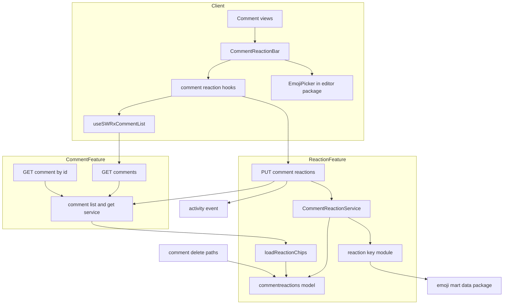
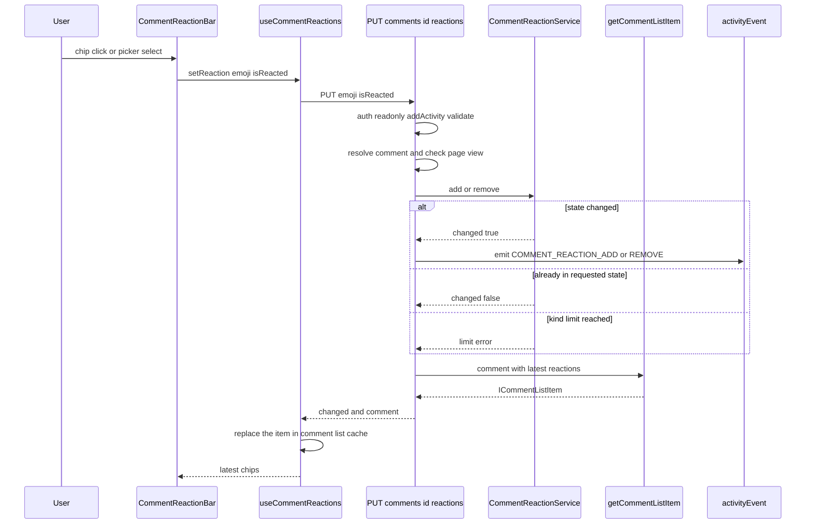
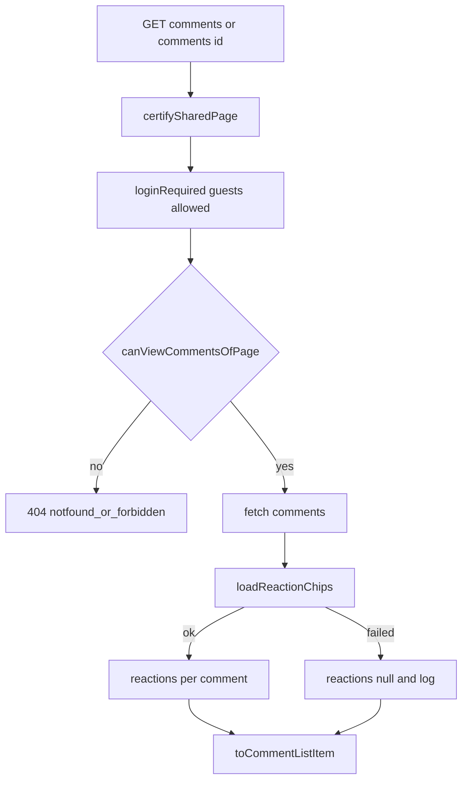

# Design Document: comment-reactions

## Overview

**Purpose**: ページのコメントに、Slack のメッセージリアクションのような絵文字リアクションを付けられるようにする。返信を書かずに、軽い意思表示ができるようにする。

**Users**: ログインユーザーは、通常コメントとインラインコメント（どちらも返信を含む）にリアクションを付けたり外したりする。ゲストと共有リンク閲覧者は、リアクションを読み取り専用で見る。API の利用者（GROWI MCP、外部スクリプト）は、コメントと一緒にリアクションを読む。管理者は、リアクションの追加・解除を監査ログで追う。

**Impact**: 新しいコレクション `commentreactions` と、追加・解除の `PUT /_api/v3/comments/:id/reactions` を足す。リアクション専用の取得 API は作らず、コメントの API に載せる。具体的には、コメント一覧 API（`GET /_api/v3/comments`）の各コメントに `reactions` を足し、コメント単体の取得 API（`GET /_api/v3/comments/:id`）を新設する。この2点は `comment` スペックの契約の変更なので、`.claude/rules/spec-lifecycle.md` に従って `comment` スペックへ書き戻す（「Amend Target」を参照）。あわせて、コメントの表示部品、コメント・ページの削除経路、監査ログの action 定義と snapshot、G2G 移行のコレクション一覧、絵文字データのパッケージを拡張する。

### Goals
- 通常コメントとインラインコメント（返信を含む）に、標準絵文字のリアクションを追加・解除できる（要件 2、3）
- 同じ絵文字をチップにまとめ、人数・自分のリアクション・リアクションした利用者を示す（要件 1）
- 肌の色を Slack 準拠（`skin-tone-2`〜`6`、肌の色ごとに別のリアクション）で扱う（要件 4）
- コメントを読む API（一覧・単体）と、リアクションを書く API の応答で、コメントとリアクションを同じ形で返す
- 監査ログへの記録、削除の連鎖、G2G 移行に対応する（要件 8、9、10）

### Non-Goals
- リアクション専用の取得 API
- 旧式の `GET /_api/comments.get` へのリアクションの追加（`comment` 要件 5.1 で挙動を変えないと決まっている）
- Slack ワークスペースのカスタム絵文字、GROWI 独自のカスタム絵文字（キーの名前空間で受け入れられる形にするだけ）
- ページそのものへのリアクション
- リアルタイム反映、通知、Slack との同期
- 複数人の絵文字での人ごとの肌の色、利用者ごとの既定の肌の色の設定（サーバーには持たない）
- エディタの絵文字入力（`EmojiButton`、自動補完）の挙動の変更

## Amend Target

本スペックは、リアクションという新しい機能を持つスペックである。それと同時に、完了済みの `comment` スペックの契約を一部変える。変える部分について、本スペックは `.claude/rules/spec-lifecycle.md` の amend spec として振る舞う。

| 対象スペック | 変わる契約 | 書き戻し先 |
|---|---|---|
| `comment` | `GET /_api/v3/comments` の応答の各コメント（`ICommentListItem`）に `reactions` を足す | requirements.md の要件 1 の末尾に受け入れ条件を追加。design.md の `ICommentListItem`、`toCommentListItem`、`list.ts` の記述 |
| `comment` | コメント単体の取得 API `GET /_api/v3/comments/:id` を新設する（応答は一覧の1件と同じ形） | requirements.md の末尾に新しい要件を追加（既存の番号は変えない）。design.md に route と service を追加 |
| `comment` | 一覧と単体の取得が、リアクションの集計（`comment-reaction` のローダー）に依存する | design.md の Allowed Dependencies |

- **Revalidation Triggers への影響**: `comment` スペックの Revalidation Triggers のうち「`ICommentListItem` の項目の追加」が発火する。MCP、SDK、画面、外部の利用者が再確認の対象になる。項目の追加で既存の項目は変えないので、後方互換である。
- **書き戻しのタスク**: tasks.md の最終タスクを「`comment` スペックへの書き戻し」とする。ルールの手順のうち、N.1（requirements.md / design.md の書き換え）、N.2（設計判断を `comment` の research.md へ移す）、N.3（`comment` の spec.json の `updated_at` の更新）を行う。書き戻した `comment` の本文は、最初からその形だったように書く（変更の経緯は書かない）。
- **本スペック自体は削除しない**: N.4（roadmap.md）は、本スペックが roadmap.md に載っていないので該当しない。N.5（自分のディレクトリの削除）も行わない。リアクションのデータ、キーの規則、追加・解除の API、表示部品は、本スペックが持ち続ける新しい機能で、spec-lifecycle の「What this does NOT apply to — A spec for new functionality」に当たるからである。書き戻すのは `comment` の契約に当たる部分（応答の項目と単体取得 API）だけで、書き戻した後は `comment` スペックがその契約の唯一の持ち主になる。
- **実装中の扱い**: `comment` スペックの本文には、書き戻しのタスクまで手を入れない（spec-lifecycle の手順 2）。

## Boundary Commitments

### This Spec Owns
- `commentreactions` コレクション（Prisma モデルのみ。Mongoose のモデル・スキーマは持たない）と、その一意性の不変条件 `(commentId, userId, emoji)`
- `commentreactions` のインデックスを作る migration script（`src/migrations/`）と、G2G 移行・インポートでの参照項目の型変換（`overwrite-params/comment-reactions.ts`）
- リアクションキーの形式（`unicode:<shortcode>[::skin-tone-<2..6>]`）と、その検証・正規化・グリフ解決（`reaction-key` モジュール）
- リアクションの集計の規則（チップの単位、並び順、人数、`reactedByMe`、利用者の整形）と、その結果の型 `ReactionChip`
- `PUT /_api/v3/comments/:id/reactions` の契約（入力、応答、認可、エラー）
- 1コメントあたりの絵文字の種類数の上限（`MAX_REACTION_KINDS_PER_COMMENT`）
- 監査ログの action `COMMENT_REACTION_ADD` / `COMMENT_REACTION_REMOVE` と、その snapshot の variant（`CommentReactionSnapshot`）
- 画面のリアクションの部品群（`CommentReactionBar` ほか）と、コメント一覧のキャッシュからリアクションを読み書きするフック
- `packages/editor` の公開コンポーネント `EmojiPicker`（エディタに依存しない、遅延読み込みのピッカー）
- `@growi/emoji-mart-data` の出力の拡張（肌の色違いのグリフ、別名の対応表）
- **書き戻しまでの間だけ**: `comment` スペックの契約の変更（`ICommentListItem.reactions`、`GET /_api/v3/comments/:id`）。書き戻した後は `comment` スペックが持つ

### Out of Boundary
- コメントの取得の認可、版を指定したときの意味、コメント件数（`comment` スペック）。本スペックは、取得の応答にリアクションを載せることと単体取得 API の新設以外は変えない。リアクションはコメント件数に数えない
- 旧式の `GET /_api/comments.get` の応答（リアクションを載せない）
- コメントの作成・編集・削除・解決の挙動（`comment.js` の apiv1、`inline-comment`）。本スペックは、削除の経路にリアクションの削除を足すことだけを持つ
- インラインコメントの型（`InlineCommentWithReplies`、`InlineCommentReply`）と `groupInlineComments`。リアクションは、これらの型を経由せずにコメント一覧のキャッシュから読む
- 共有リンクの有効性の判定と、共有リンク閲覧者を読み取り専用とする方針（`share-link-comments`）
- 共有リンクの画面と検索結果のプレビューでインラインコメントを出さない方針（`comment` 要件 6.5、`inline-comment` 要件 6）
- snapshot の判別可能ユニオンという仕組み自体（`activity-log-snapshot`）。本スペックは variant を1つ足すだけ
- 監査ログ画面の表示（`activity-log-snapshot-viewer`）
- エディタの `EmojiButton` と絵文字の自動補完
- GROWI MCP サーバーと SDK（別リポジトリ）。`reactions` を使うかどうかは、それぞれの側で決める
- `comments` の既存の Mongoose スキーマ（`features/comment/server/models/comment.ts`。インデックス作成と G2G のインポートの型変換に使われている）の退役。本スペックはそれに触れず、手も足さない

### Allowed Dependencies
モジュール単位の依存は、次の層の順で左（番号の小さい側）にだけ向ける。循環は作らない。

1. **リアクションの中核**（`features/comment-reaction/` の `interfaces`、`utils`、`server/models`、`server/service`）: Prisma（`commentreactions`）、`@growi/emoji-mart-data`、`comment` の型 `ICommentCreatorSummary`（型だけ）に依存してよい。`comment` の実行時のコードは import しない。利用者の整形は、関数を引数で受け取る
2. **コメントの取得**（`features/comment/server/` の service、serializers、`list.ts`、新設の `get.ts`）: 1 のローダー `loadReactionChips` と型 `ReactionChip` に依存してよい
3. **リアクションの書き込みの route**（`features/comment-reaction/server/routes/update.ts`）: 1 と、2 の `getCommentListItem`（応答のコメントを作るため）に依存してよい
4. **クライアント**: `comment-reaction` の client は、`comment` の client の `useSWRxCommentList` に依存してよい。コメントの表示部品（`client/components/PageComment/`、`features/inline-comment/client/`）は、`comment-reaction` の client の部品に依存してよい。逆向きは禁止

その他:
- `comments` と `commentreactions` の読み書きは Prisma だけで行う。本スペックは、Mongoose のモデル・スキーマを新しく作らず、既存の Mongoose スキーマ（`comments`、`activities`）にも項目を足さない。Mongoose が担っていた操作のうち必要なもの（インデックスの作成、インポート時の ObjectId への型変換）は、migration script と import の `overwrite-params` で補う
- サーバーの認可は、既存の部品（`accessTokenParser`、`certifySharedPage`、`loginRequiredFactory`、`excludeReadOnlyUserIfCommentNotAllowed`、`generateAddActivityMiddleware`、`apiV3FormValidator`、`findPageAndMetaDataByViewer`）だけで組む。並行実装しない
- 削除の経路（`removeWithReplies`、`deleteReply`、`deleteCompletelyOperation`）は、Prisma の `commentreactions` だけを直接使う。`comment-reaction` のコードは import しない
- クライアントは、`states/context.ts` のフック、`useIsCommentActionBlockedForReadOnlyUser`、`useIsTrashPage`、`apiv3-client`、`toastr`、reactstrap、`@growi/editor/dist/client/components/EmojiPicker` を使ってよい

### Revalidation Triggers
- リアクションキーの形式の変更（名前空間の追加、肌の色の表記の変更）。G2G で運んだ既存データ、監査ログの snapshot、将来の Slack 連携に影響する
- `ReactionChip` の項目の変更、または `ICommentListItem.reactions` の意味（`null` と空配列の区別）の変更。一覧・単体・PUT の3つの応答と、MCP・SDK・画面に影響する
- `PUT /_api/v3/comments/:id/reactions` の入力・応答・認可の変更
- `comment` スペックのコメント取得の認可の変更（リアクションの読み取りの範囲も同時に変わる）
- コメントの削除の経路の追加・変更（新しい経路でリアクションの削除が漏れる）
- `@growi/emoji-mart-data` の出力形の変更（本文のレンダラー、エディタの自動補完、本スペックの検証が共有している）
- `ICommentCreatorSummary` の項目の変更（リアクションした利用者の情報も同じ規則に従う。要件 6.4）
- emoji-mart のバージョン更新（ショートコードの変化で、保存済みのキーが解決できなくなる）
- コメント一覧の取得フックのキー `['/comments', pageId, shareLinkId]` の変更（PUT の応答でキャッシュを書き換える前提が崩れる）
- `commentreactions` に `comments` / `pages` へのリレーションを宣言すること、またはコメントを削除する経路の追加（どちらも、削除の順番を誤ると P2014 でコメントが削除できなくなる。「削除経路の拡張」を参照）
- Prisma で `users` を物理削除する経路の追加（`commentreactions.user` の必須のリレーションにより、リアクションの付いた利用者の削除が P2014 で失敗する）
- `commentreactions` のインデックスのキー・名前の変更（migration と Prisma の `@@unique` / `@@index` の `map` を一致させ続ける必要がある）、または参照項目（`comment` / `page` / `user`）の追加・改名（G2G の `overwrite-params` の更新が要る）

## Architecture

### Existing Architecture Analysis
- コメントは `comments` コレクションに、通常コメントとインラインコメント（`isInline`）が同居している。取得は `GET /_api/v3/comments`（`features/comment/server/routes/list.ts` → `service/comment-list.ts` → `serializers/to-comment-list-item.ts`）。コメント単体を取得する API は無い。
- 画面は、共有の取得フック `useSWRxCommentList`（キー `['/comments', pageId, shareLinkId]`）から、`useSWRxPageComment`（通常コメント）と `useSWRxInlineComments`（`groupInlineComments` でインラインコメントを組み直す）を派生させている。`groupInlineComments` は必要な項目だけを写すので、`ICommentListItem` に項目を足しても、インラインコメントの型には現れない。
- `certifySharedPage` は、`pageId`（query または body）と `shareLinkId` の組で共有リンクを検証する。`pageId` が無い要求は検証しない。
- 書き込みは、通常コメントが apiv1（`server/routes/comment.js`）、インラインコメントが apiv3（`features/inline-comment/server/routes/`）。
- 表示は共通の外枠 `CommentCard`（slot: `headerEnd` / `beforeBody` / `children` / `footer`）。
- Mongoose は退役予定で、本スペックは Mongoose 側の実装を足さない。Mongoose スキーマを持たない Prisma だけのコレクションは、Prisma がインデックスを作らない（`prisma db push` はデプロイで実行されない）ので、一意インデックスは migration script で作る。前例は `src/migrations/20260619120000-add-unique-key-index-to-auditlog-es-sync-collections.js`。migration（migrate-mongo）は、本番ではサーバーの起動前（`preserver`、Docker の entrypoint）に、統合テストではテンプレート DB の作成時に実行される。
- G2G 移行とファイルからのインポートは、どちらも `ImportService.convertDocuments` で文書を変換する。Mongoose のモデルがあるコレクションは、そのスキーマで各項目を型変換する。モデルが無いコレクションは、`_id` を ObjectId に、ISO 形式の文字列を Date に戻すだけで、ほかの ObjectId の参照項目は文字列のまま入る（エクスポートは JSON 文字列化するため）。ただし、コレクションごとの `overwrite-params`（`generateOverwriteParams`）は、モデルの有無にかかわらず G2G とファイルインポートの両方で適用される。`flushAndInsert` は `deleteMany({})` で空にするので、インデックスは残る。

### Architecture Pattern & Boundary Map



**Architecture Integration**:
- 選んだ形: リアクションは、コメントの API の一部として読み書きする。読み取りは `comment` の取得（一覧・単体）がリアクションの集計を取り込み、書き込みは `comments` の下のサブリソース `/comments/:id/reactions` にする。3つの応答（一覧の1件、単体、PUT）は同じ `ICommentListItem` の形を返す。
- 境界: リアクションのデータ・規則・集計・書き込みは `comment-reaction` が持つ。コメントの形と取得の認可は `comment` が持つ。`comment` は集計の関数を呼ぶだけで、リアクションの規則を知らない。
- 守る既存のパターン: apiv3 の route handler factory、404 一様応答、`addActivity` の正規の順序、Prisma だけのコレクションのインデックスを migration で作る前例（`auditlog_es_sync_status`）、コレクションごとの import の `overwrite-params`、共有の取得フックからの派生。
- 新しい部品の理由: 単体取得 API は、一覧と同じ形でコメント1件を読む手段で、PUT の応答と同じ組み立て（`getCommentListItem`）を共有する。`reaction-key` を独立させるのは、サーバーの検証とクライアントの表示・変換で同じ規則を使うため。
- Steering との整合: Feature-Based Architecture、server/client の分離、Jotai/SWR の使い分け、named export、テストの co-location、executor は作業対象を引数で受け取る（ローダーは利用者の整形関数を引数で受け取る）。

### Technology Stack

| Layer | Choice / Version | Role in Feature | Notes |
|-------|------------------|-----------------|-------|
| Frontend | React（Next.js Pages Router）、SWR、reactstrap | リアクションバー、チップ、利用者一覧のツールチップ | 既存のスタック |
| Frontend | emoji-mart 5.6.0、@emoji-mart/react 1.1.1、@emoji-mart/data 1.2.1（`packages/editor` 内） | 絵文字ピッカー（肌の色の選択） | 新しい依存は無い。`packages/editor` の既存の依存を使う |
| Shared | `@growi/emoji-mart-data`（workspace） | 絵文字の存在・肌の色対応・別名・グリフの解決 | 出力を拡張する |
| Backend | Express apiv3、express-validator | コメントの読み取り（一覧・単体）とリアクションの書き込み | 既存のスタック |
| Data | MongoDB、Prisma（mongodb プロバイダ）、migrate-mongo | `commentreactions` の永続化（Prisma で読み書き）、インデックスの作成（migration script） | 新しいコレクション。Mongoose は使わない |

## File Structure Plan

### Directory Structure
```
apps/app/src/features/comment-reaction/
├── interfaces/
│   ├── index.ts                     # 公開する型と定数の barrel
│   ├── reaction-key.ts              # ReactionKey、ParsedReactionKey、SkinTone の型
│   ├── reaction-chip.ts             # ReactionChip、ReactionUser
│   ├── api.ts                       # PUT の要求・応答の型
│   └── limits.ts                    # MAX_REACTION_KINDS_PER_COMMENT
├── utils/
│   ├── index.ts                     # barrel
│   ├── reaction-key.ts              # parse / normalize / toSlackName / fromPickerSelection / resolveGlyph（純粋関数、サーバーとクライアントで共有）
│   └── reaction-key.spec.ts
├── server/
│   ├── index.ts                     # comment から使うローダーの export
│   ├── models/
│   │   ├── index.ts
│   │   ├── comment-reaction.ts      # Prisma 拡張（_id / __v）だけ。Mongoose のスキーマ・モデルは作らない
│   │   └── comment-reaction.integ.ts
│   ├── service/
│   │   ├── comment-reaction-service.ts       # addReaction / removeReaction（上限、冪等）
│   │   ├── comment-reaction-service.integ.ts
│   │   ├── load-reaction-chips.ts            # コメント ID 群 → コメントごとのチップ（comment の取得から呼ばれる）
│   │   ├── load-reaction-chips.integ.ts
│   │   ├── summarize-reactions.ts            # 行の配列 → コメントごとのチップ（並び順・利用者の整形を含む純粋関数）
│   │   └── summarize-reactions.spec.ts
│   └── routes/
│       ├── update.ts                # PUT /_api/v3/comments/:id/reactions（@swagger を含む）
│       └── update.integ.ts
└── client/
    ├── hooks/
    │   ├── use-comment-reactions.ts          # コメント一覧のキャッシュから1コメント分のチップを読み、PUT の応答でキャッシュの1件を置き換える
    │   ├── use-comment-reactions.spec.tsx
    │   ├── use-can-react-to-comments.ts      # 画面上でリアクションできるかの判定
    │   └── use-can-react-to-comments.spec.ts
    └── components/
        ├── index.ts                 # 公開: CommentReactionBar だけ
        └── CommentReactionBar/
            ├── CommentReactionBar.tsx       # 1コメント分のチップ列と「＋」
            ├── CommentReactionBar.spec.tsx
            ├── CommentReactionBar.module.scss
            ├── ReactionChip.tsx             # 絵文字・人数・自分の強調・押下、利用者一覧のツールチップ
            └── AddReactionButton.tsx        # 「＋」とピッカーの開閉、上限時の無効化

apps/app/src/features/comment/server/
├── routes/
│   ├── get.ts                       # 新設: GET /_api/v3/comments/:id（@swagger を含む）
│   └── get.integ.ts
├── service/
│   ├── comment-get.ts               # 新設: getCommentListItem（1件の取得 → リアクションの取り込み → 整形）
│   └── comment-get.integ.ts
└── authorization/
    ├── can-view-comments-of-page.ts       # 新設: list.ts の閲覧判定（共有リンク or 閲覧権限）を取り出し、一覧と単体で共有
    └── can-view-comments-of-page.integ.ts

apps/app/src/migrations/
├── <YYYYMMDDHHmmss>-add-indexes-to-commentreactions.js     # 新設: 一意インデックスと page インデックスを作る（前例: 20260619120000-add-unique-key-index-to-auditlog-es-sync-collections.js）
└── <YYYYMMDDHHmmss>-add-indexes-to-commentreactions.integ.ts

apps/app/src/server/service/import/overwrite-params/
├── comment-reactions.ts             # 新設: インポート時に comment / page / user を ObjectId に戻す
└── comment-reactions.spec.ts

packages/editor/src/client/components/EmojiPicker/
├── EmojiPicker.tsx                  # 遅延読み込みの emoji-mart ピッカー（肌の色の選択あり）。エディタに依存しない
├── EmojiPicker.spec.tsx
└── index.ts
```

### Modified Files
**comment スペックの契約に当たる変更（書き戻しの対象）**
- `apps/app/src/features/comment/interfaces/comment-list.ts` — `ICommentListItem` に `reactions: ReactionChip[] | null` を追加。単体取得の要求・応答の型（`GetCommentRequestQuery`、`GetCommentResponseBody`）を追加。
- `apps/app/src/features/comment/server/serializers/to-comment-list-item.ts` — `toCommentListItem` が、行と、そのコメントのチップ（または `null`）を受け取って `reactions` を詰める。`toCreatorSummary` を export する（挙動は変えない）。`toLegacyCommentListItem`（旧 API 用）は `reactions` を持たない形のまま。
- `apps/app/src/features/comment/server/routes/list.ts` — 一覧の取得のあと、`loadReactionChips` でリアクションを取り込む。閲覧判定は `can-view-comments-of-page.ts` に移す（挙動は変えない）。`@swagger` の `CommentListItem` に `reactions` を追加。
- `apps/app/src/server/routes/apiv3/index.js` — `/comments` の router に `GET /:id`（comment）と `PUT /:id/reactions`（comment-reaction）を登録。

**本スペックの機能に当たる変更**
- `apps/app/prisma/schema.prisma` — `model commentreactions` を追加。リレーションは `users` への1本だけを宣言し、`users` に逆向きのリレーション項目を追加する（データベースは変わらない）。`comments` と `pages` へのリレーションは宣言しない（`commentId` と `pageId` はスカラーの項目だけ。「削除経路の拡張」を参照）。`type ActivitiesSnapshot` に `emoji String?` を追加。
- `apps/app/src/utils/prisma.ts` — `CommentReactionExtension` を `$extends` の連鎖に追加。
- `apps/app/src/features/comment/server/models/comment.ts` — `removeWithReplies` で、返信の ID を集めてから、配列形式のトランザクションの**先頭**で `commentreactions.deleteMany({ commentId: { in: [本体, ...返信] } })` を実行し、そのあとに既存の返信の削除、本体の削除を続ける（子から親の順）。変えるのは Prisma 拡張の部分だけで、同じファイルの Mongoose スキーマには触れない。
- `apps/app/src/features/inline-comment/server/service/inline-comment-service.ts` — `deleteReply` を、`commentreactions.deleteMany({ commentId })` → 返信の削除、の順の配列形式のトランザクションにする（起点の削除は `removeWithReplies` でカバーされる）。
- `apps/app/src/server/service/page/delete-completely-operation.ts` — 既存のコメント削除の配列形式のトランザクションの**先頭**に `commentreactions.deleteMany({ pageId: { in: pageIdStrings } })` を追加する（リアクション → 返信 → コメントの順）。
- `apps/app/src/interfaces/activity.ts` — `ACTION_COMMENT_REACTION_ADD` / `ACTION_COMMENT_REACTION_REMOVE` を `SupportedAction` と `MediumActionGroup` に追加。`CommentReactionSnapshot` を定義して `ISnapshot` に追加。
- `apps/app/src/server/service/import/non-transferable-collections.ts` — `TRANSFERABLE_COLLECTIONS` に `'commentreactions'` を追加。
- `apps/app/src/server/service/import/overwrite-params/index.ts` — `generateOverwriteParams` に `case 'commentreactions'` を追加し、`comment-reactions.ts` の params を返す。
- `apps/app/src/client/components/PageComment/Comment.tsx` — `CommentCard` の `footer` に `CommentReactionBar` を追加（`isReadOnly` を渡す）。
- `apps/app/src/features/inline-comment/client/components/InlineCommentItem/InlineCommentItem.tsx`、`InlineCommentReplies.tsx`、`InlineCommentBodyInteraction/InlineCommentPopoverEntry.tsx` — `footer` に `CommentReactionBar` を追加。`CollapsedInlineCommentItem` には追加しない（折りたたみ表示では本文も出さないため）。
- `apps/app/public/static/locales/{en_US,fr_FR,ja_JP,ko_KR,zh_CN}/translation.json` — `comment_reaction.*` の文言を追加。
- `apps/app/public/static/locales/{en_US,fr_FR,ja_JP,ko_KR,zh_CN}/admin.json` — `COMMENT_REACTION_ADD` / `COMMENT_REACTION_REMOVE` の表示名を追加。
- `packages/emoji-mart-data/bin/extract.ts` — 肌の色に対応する絵文字は6件の `skins`（既定＋`skin-tone-2`〜`6`）を出力し、名前付き export `aliases` を追加する。型 `NativeLookup` の `skins` を非空タプル `readonly [{ native: string }, ...{ native: string }[]]` にする。

**書き戻し（最終タスク）で変更する spec のファイル**
- `.kiro/specs/comment/requirements.md`、`design.md`、`research.md`、`spec.json`（「Amend Target」を参照）

## System Flows

### リアクションの追加・解除



- emit は `res.apiv3()` より前に行う（`activity-recording.md` Rule 1）。`changed: false` のときは emit しない（要件 9.4）。
- 一意インデックスの重複エラー（同時の二重追加）は `changed: false` として扱う（要件 2.7）。
- 上限で拒否したときは 409 を返し、コメントは読み直さない。
- 応答のコメントは、書き込みのあとにデータベースから読み直したもので、他の利用者のリアクションも含む最新の状態である（要件 2.9）。クライアントは、一覧のキャッシュの該当する1件だけを置き換え、一覧全体は再取得しない。

### コメントの読み取り（一覧・単体）とリアクションの取り込み



- 一覧と単体は、同じ閲覧判定（`canViewCommentsOfPage`）と同じ整形（`toCommentListItem`）を使う。リアクションは、コメントを読める相手にだけ、コメントと一緒に返る（要件 6.1）。
- リアクションの取り込みに失敗しても、コメントは返す。その場合 `reactions` を `null` にしてログを残す（要件 6.5）。コメント自体の取得の失敗は、従来どおり 500。

## Requirements Traceability

| Requirement | Summary | Components | Interfaces | Flows |
|-------------|---------|------------|------------|-------|
| 1.1, 1.2, 1.3 | 絵文字ごとのチップ、人数、肌の色ごとに別チップ | summarizeReactions, ReactionChip | `ReactionChip.emoji` / `count` | — |
| 1.4 | 自分のリアクションの区別 | summarizeReactions, ReactionChip | `ReactionChip.reactedByMe`、`aria-pressed` | — |
| 1.5, 1.10 | リアクションした利用者の表示、退会者は投稿者と同じ規則 | summarizeReactions, ReactionChip | `ReactionUser`（`ICommentCreatorSummary` または ID 文字列） | — |
| 1.6 | 最初に付いた順 | summarizeReactions | チップの並び（残っている行の最小 `createdAt` の昇順） | — |
| 1.7 | リアクションが無ければチップなし | CommentReactionBar | `reactions: []` | — |
| 1.8 | 末尾のコメント欄とインラインコメントの両方 | CommentReactionBar の差し込み先 | `CommentCard.footer` | — |
| 1.9 | 退会・削除された利用者も人数に数える | summarizeReactions | `count` は行数 | — |
| 2.1, 2.2, 2.3 | チップの押下で追加・解除、0 で非表示 | ReactionChip, useCommentReactions, update route | `PUT /comments/:id/reactions` | 追加・解除 |
| 2.4, 2.5 | 同一絵文字は1つ、異なる絵文字は複数 | commentreactions model, index migration | 一意インデックス `(comment, user, emoji)`（migration で作成） | — |
| 2.6 | 自分のコメントにも付けられる | CommentReactionService | 投稿者の判定をしない | — |
| 2.7, 2.8 | 古い画面からの重複要求は成功扱い | CommentReactionService | `{ changed: false }` | 追加・解除 |
| 2.9 | 完了後に最新の状態を表示 | update route, getCommentListItem, useCommentReactions | PUT の応答の `comment`、キャッシュの1件の置き換え | 追加・解除 |
| 2.10 | 失敗の表示と操作前の状態 | useCommentReactions, CommentReactionBar | `toastError`、楽観的更新なし | — |
| 3.1, 3.2 | 「＋」でピッカーを開く | AddReactionButton, EmojiPicker | `EmojiPickerProps` | — |
| 3.3, 3.4 | 新規はチップ追加、既存は追加と同じ扱い | AddReactionButton, reaction-key | `fromPickerSelection` → PUT | 追加・解除 |
| 3.5 | 肌の色の選択 | EmojiPicker | emoji-mart の `skin` / `skinTonePosition` | — |
| 3.6 | 閉じたら変更しない | AddReactionButton | `onClose` | — |
| 3.7 | インラインコメントと返信にも「＋」と追加・解除 | CommentReactionBar の差し込み先 | — | — |
| 4.1, 4.2 | 標準絵文字だけ、存在しない絵文字は拒否 | reaction-key, update route | 400 `invalid-reaction-emoji` | — |
| 4.3, 4.4 | 肌の色は 2〜6、非対応の絵文字への肌の色は拒否 | reaction-key | `ParsedReactionKey.skinTone` | — |
| 4.5 | 別名を1つの絵文字として扱う | reaction-key | `normalizeReactionKey` | — |
| 4.6 | Slack のリアクション名と1対1 | reaction-key | `toSlackReactionName` | — |
| 5.1, 5.2 | 閲覧権限のあるログインユーザーだけ | update route | `loginRequiredStrictly`、閲覧判定 | — |
| 5.3 | 権限なし・存在しないコメントは同じ応答 | update route | 404 `notfound_or_forbidden` | — |
| 5.4, 5.5 | 閲覧専用ユーザーはコメント設定に連動 | update route, useCanReactToComments | `excludeReadOnlyUserIfCommentNotAllowed`、`useIsCommentActionBlockedForReadOnlyUser` | — |
| 5.6, 5.7 | 共有リンク・ゲストは手段なし | useCanReactToComments, update route | `loginRequiredStrictly`、「＋」非表示、チップは非活性 | — |
| 6.1 | コメントを読める相手と同じ範囲で返す | comment の list / get route, loadReactionChips | `ICommentListItem.reactions` | 読み取り |
| 6.2 | ゲスト・共有リンクにも読み取り専用で表示 | CommentReactionBar | `canReact = false` | — |
| 6.3 | 共有リンク画面・検索プレビューでインラインのリアクションを出さない | 差し込み先の選定 | インラインコメントの部品が描画されない画面には出ない | — |
| 6.4 | 利用者情報は4項目 | summarizeReactions | `toCreatorSummary` を引数で渡す | — |
| 6.5 | 取得失敗はコメント表示を妨げない | comment の list / get route, CommentReactionBar | `reactions: null`、バーを描画しない | 読み取り |
| 7.1, 7.2, 7.3 | 種類数の上限 20、超えたら拒否、既存チップは可 | CommentReactionService, AddReactionButton | 409 `reaction-kind-limit-exceeded`、`MAX_REACTION_KINDS_PER_COMMENT` | 追加・解除 |
| 8.1 | 通常コメントの削除でリアクションも削除 | removeWithReplies | `commentreactions.deleteMany` | — |
| 8.2 | インラインコメントとその返信の削除 | removeWithReplies, deleteReply | 同上 | — |
| 8.3 | ページの完全削除 | deleteCompletelyOperation | `deleteMany({ pageId: { in } })` | — |
| 8.4 | ごみ箱から戻したら元どおり | （変更なし） | ごみ箱の経路はリアクションに触れない | — |
| 9.1, 9.2 | 追加・解除を監査ログに記録 | update route | `COMMENT_REACTION_ADD` / `_REMOVE`、`CommentReactionSnapshot` | 追加・解除 |
| 9.3 | 既存のコメント操作と同じ分類 | activity.ts | `/^COMMENT_/` のカテゴリ、`MediumActionGroup` | — |
| 9.4 | 状態不変・拒否は記録しない | update route | `changed` が true のときだけ emit | 追加・解除 |
| 9.5 | 通知しない | activity.ts | `EssentialActionGroup` に入れない | — |
| 10.1, 10.2 | G2G で移す、同じ対応で表示 | import overwrite params, non-transferable-collections, index migration | `TRANSFERABLE_COLLECTIONS`、`overwrite-params` による ObjectId の型変換、移行先のインデックスは移行先の migration で作成済み | — |

コメント単体の取得 API（`GET /_api/v3/comments/:id`）は、本スペックの requirements.md の要件には対応しない。`comment` スペックの契約として書き戻し、`comment` の requirements.md の新しい要件に対応づける（「Amend Target」を参照）。

## Components and Interfaces

| Component | Domain/Layer | Intent | Req Coverage | Key Dependencies (P0/P1) | Contracts |
|-----------|--------------|--------|--------------|--------------------------|-----------|
| reaction-key | Reaction core / utils | キーの検証・正規化・変換・グリフ解決 | 3.3, 4.1–4.6 | `@growi/emoji-mart-data`（P0） | Service |
| commentreactions model | Reaction core / data | 永続化と Prisma 拡張（Prisma のみ） | 2.4, 2.5 | Prisma（P0） | State |
| index migration | Migration | 一意インデックスと page インデックスの作成 | 2.4, 2.5, 10.2 | migrate-mongo（P0） | Batch |
| import overwrite params | Import（既存の仕組み） | G2G・インポートでの参照項目の ObjectId への型変換 | 10.1, 10.2 | ImportService（P0） | Batch |
| CommentReactionService | Reaction core / service | 追加・解除の業務規則（冪等、上限） | 2.4–2.8, 7.1–7.3 | model（P0）、reaction-key（P0） | Service |
| summarizeReactions | Reaction core / service | 行 → チップの集計（純粋関数） | 1.1–1.6, 1.9, 1.10, 6.4 | — | Service |
| loadReactionChips | Reaction core / service | コメント ID 群のチップを読む（comment の取得が呼ぶ） | 1.1–1.6, 1.9, 6.1 | model（P0）、summarizeReactions（P0） | Service |
| comment の取得の拡張 | Comment / service, route | 一覧・単体の応答にリアクションを載せる、単体取得 API | 2.9, 6.1, 6.5 | loadReactionChips（P0）、認可ミドルウェア（P0） | API, Service |
| update route | Reaction / route | 追加・解除の API と認可、監査ログ、最新のコメントの返却 | 2.1, 2.2, 2.9, 4.2, 4.4, 5.1–5.7, 7.2, 9.1–9.4 | Service（P0）、getCommentListItem（P0）、activityEvent（P0） | API |
| 削除経路の拡張 | 既存 | コメント・ページの削除に伴う削除 | 8.1–8.4 | Prisma（P0） | — |
| Activity 定義の拡張 | 既存 interfaces | action と snapshot の variant | 9.1–9.5 | activity-log-snapshot の方針（P1） | — |
| useCommentReactions | Client / hook | 一覧のキャッシュから読み、PUT の応答で1件を置き換える | 1.1, 2.1, 2.2, 2.9, 2.10, 6.5 | useSWRxCommentList（P0）、apiv3-client（P0） | State |
| useCanReactToComments | Client / hook | 画面上のリアクション可否 | 5.4–5.7, 6.2 | context フック（P0） | State |
| CommentReactionBar | Client / UI | 1コメント分のチップ列と「＋」 | 1.1–1.8, 2.3, 3.1, 3.7, 6.2, 6.3, 6.5 | hooks（P0） | — |
| ReactionChip | Client / UI | チップの表示と押下、利用者一覧 | 1.2, 1.4, 1.5, 1.10, 2.1, 2.2 | reaction-key（P0） | — |
| AddReactionButton | Client / UI | 「＋」とピッカー、上限時の無効化 | 3.1–3.6, 7.2 | EmojiPicker（P0） | — |
| EmojiPicker | editor package / UI | 遅延読み込みのピッカー | 3.2, 3.5, 3.6 | emoji-mart（P0） | — |

### Reaction core

#### reaction-key

| Field | Detail |
|-------|--------|
| Intent | リアクションキーの唯一の規則（形式、検証、正規化、Slack 名・ピッカー出力との変換、グリフ解決） |
| Requirements | 3.3, 4.1, 4.2, 4.3, 4.4, 4.5, 4.6 |

**Responsibilities & Constraints**
- キーの形式は `unicode:<shortcode>` または `unicode:<shortcode>::skin-tone-<n>`（n は 2〜6）。v1 で受け付ける名前空間は `unicode` だけ。
- 存在の判定、肌の色対応の判定、別名の解決は `@growi/emoji-mart-data` だけを根拠にする（本文のレンダラーと同じデータ）。
- サーバー（検証）とクライアント（ピッカーの出力の変換、グリフの表示）の両方から使う。副作用を持たない。

**Dependencies**
- External: `@growi/emoji-mart-data`（`default` の lookup と `aliases`）— 存在・肌の色・別名・グリフ（P0）

**Contracts**: Service [x]

##### Service Interface
```typescript
type SkinTone = 2 | 3 | 4 | 5 | 6;

/** Canonical stored form, e.g. 'unicode:+1' or 'unicode:+1::skin-tone-3'. */
type ReactionKey = string & { readonly __brand: 'ReactionKey' };

type ParsedReactionKey = {
  readonly namespace: 'unicode';
  readonly shortcode: string;        // canonical emoji-mart id (aliases resolved)
  readonly skinTone: SkinTone | null;
};

type ReactionKeyError =
  | { readonly kind: 'malformed' }
  | { readonly kind: 'unsupported-namespace'; readonly namespace: string }
  | { readonly kind: 'unknown-emoji'; readonly shortcode: string }
  | { readonly kind: 'skin-tone-not-supported'; readonly shortcode: string };

type Result<T, E> = { readonly ok: true; readonly value: T } | { readonly ok: false; readonly error: E };

/** Validates and canonicalizes (alias -> id). The only way to obtain a ReactionKey. */
declare function normalizeReactionKey(input: string): Result<ReactionKey, ReactionKeyError>;
declare function parseReactionKey(key: ReactionKey): ParsedReactionKey;
/** Strips the namespace: 'unicode:+1::skin-tone-3' -> '+1::skin-tone-3'. */
declare function toSlackReactionName(key: ReactionKey): string;
/** Converts the emoji-mart onEmojiSelect payload ({ id, skin? }) to a key. skin 1 or absent = no tone. */
declare function fromPickerSelection(selection: { readonly id: string; readonly skin?: number }): Result<ReactionKey, ReactionKeyError>;
/** Native glyph for display; null when the emoji data no longer knows the key. */
declare function resolveReactionGlyph(key: ReactionKey): string | null;
```
- Preconditions: なし（どの文字列でも受け付け、不正なら `ok: false`）。
- Postconditions: `normalizeReactionKey` が返すキーは、別名が解決済みで、肌の色はその絵文字が対応している場合だけ付く。同じ絵文字・同じ肌の色は常に同じ文字列になる。
- Invariants: `normalizeReactionKey` は冪等（正規化済みのキーを通しても同じキーが返る）。

**Implementation Notes**
- Integration: グリフは、肌の色なしなら `skins[0]`、`skin-tone-n` なら `skins[n - 1]`（`skins[1..5]` が U+1F3FB〜U+1F3FF）。
- Validation: 全件の往復（`fromPickerSelection` → `toSlackReactionName`）と、別名・肌の色・不正な形式の表を単体テストで網羅する。
- Risks: emoji-mart の id と Slack の名前のずれ（Open Questions を参照）。

#### commentreactions model

| Field | Detail |
|-------|--------|
| Intent | `commentreactions` の永続化（Prisma のみ） |
| Requirements | 2.4, 2.5 |

**Responsibilities & Constraints**
- Prisma モデル: 項目は「Physical Data Model」のとおり。リレーションは `users` への1本だけを宣言する。`comments` と `pages` へのリレーションは宣言しない（理由は「削除経路の拡張」を参照）。`@@unique([commentId, userId, emoji], map: "comment_1_user_1_emoji_1")`、`@@index([pageId], map: "page_1")` を宣言する。宣言は型と `findUnique` のためで、実際のインデックスは migration が作る（Prisma は作らない）。`map` の名前は migration のインデックス名と一致させる。
- Prisma 拡張: `result.commentreactions._id` / `__v` を `id` / `v` から計算する（`.claude/rules/model.md`）。`setupIndependentModels` には登録しない（Mongoose のモデルが無いため）。
- Mongoose のスキーマ・モデルは作らない。コレクションは、migration の `createIndex`（コレクションが無ければ作る）か、最初の書き込みで作られる。

**Contracts**: State [x]

##### State Management
- State model: 1行 = 1人の利用者が1つのコメントに付けた1つの絵文字。更新はしない（追加と削除だけ）。
- Persistence & consistency: 一意性は、migration が作る一意インデックスが保証する。migration はサーバーの起動前に実行されるので、サーバーが書き込む時点でインデックスは存在する。
- Concurrency strategy: 同時の二重追加は、一意インデックスの重複エラーで片方が失敗し、サービスが `changed: false` に読み替える。

#### index migration

| Field | Detail |
|-------|--------|
| Intent | `commentreactions` の一意インデックスと `page` インデックスを作る migrate-mongo の migration script |
| Requirements | 2.4, 2.5, 10.2 |

**Responsibilities & Constraints**
- `src/migrations/20260619120000-add-unique-key-index-to-auditlog-es-sync-collections.js` と同じ形にする（`mongoose.connect(getMongoUri(), mongoOptions)` で接続し、`mongoose.connection.collection('commentreactions')` に対して操作する。Mongoose のモデルは使わない）。
- `up`:
  1. 重複の除去: `(comment, user, emoji)` が同じ文書が複数あれば、`_id` が最も古い1件を残して消す（残す文書の `createdAt` がチップの並び順の根拠なので、古いほうを残す）。通常は空のコレクションで何もしないが、migration より前に書き込まれた環境（開発環境など）でも一意インデックスの作成が失敗しないようにする。
  2. `createIndex({ comment: 1, user: 1, emoji: 1 }, { unique: true, name: 'comment_1_user_1_emoji_1' })`
  3. `createIndex({ page: 1 }, { name: 'page_1' })`
  - `createIndex` は、コレクションが無ければ作り、同じインデックスがあれば何もしないので、何度実行しても安全。
- `down`: 2つのインデックスを、コレクションとインデックスがあるときだけ消す（前例の `dropIndexIfExists` と同じ）。
- 実行のタイミング: 本番はサーバーの起動前（`preserver` の `pnpm run migrate`、Docker の entrypoint）。統合テストはテンプレート DB の作成時。どちらでも、サーバーやテストが書き込む前にインデックスがある。
- `prisma/migrate.ts`（umzug）も存在するが、`prisma/migrations/` に前例が無いので使わない。

**Contracts**: Batch [x]

##### Batch / Job Contract
- Trigger: migrate-mongo の `up`（デプロイ時、テストのテンプレート DB 作成時）。
- Input / validation: `commentreactions` コレクション（無くてもよい）。
- Output / destination: 2つのインデックス。名前は Prisma の `map` と一致させる。
- Idempotency & recovery: 何度実行しても同じ結果。`down` で元に戻せる。

#### import overwrite params（comment-reactions）

| Field | Detail |
|-------|--------|
| Intent | G2G 移行とファイルからのインポートで、`commentreactions` の参照項目を ObjectId に戻す |
| Requirements | 10.1, 10.2 |

**Responsibilities & Constraints**
- Mongoose のモデルが無いコレクションは、`convertDocuments` が `_id` と日付しか型変換しない。そのまま入ると `comment` / `page` / `user` が文字列になり、Prisma の `@db.ObjectId` の検索（`commentId: { in: [...] }` など）に一致しなくなる。
- `overwrite-params/comment-reactions.ts` は `{ comment, page, user }` のそれぞれに、文字列を `new Types.ObjectId(value)` に変える関数を返す（既存の `overwrite-params/pages.ts` / `revisions.ts` と同じく、mongoose パッケージの `Types` を使う。モデルは使わない）。値が ObjectId として不正なら、そのまま返す（`keepOriginal` と同じ扱い）。
- `generateOverwriteParams` に `case 'commentreactions'` を足す。この関数は、ファイルからのインポート（`import-settings-builder.ts`）と G2G（`g2g-transfer.ts`）の両方から呼ばれるので、どちらの経路でも型変換される。
- 一意キーの衝突の検出（`detect-unique-conflicts.ts`）には加えない。対象は環境をまたいで自然キーが衝突しうるコレクションだけで、ObjectId で決まる一意キーは対象外。

**Contracts**: Batch [x]

##### Batch / Job Contract
- Trigger: `ImportService.convertDocuments` が `commentreactions` の各文書を変換するとき。
- Input / validation: エクスポートされた JSON の文書（参照項目は 24 桁の16進文字列）。
- Output / destination: 参照項目が ObjectId になった文書。
- Idempotency & recovery: 既に ObjectId の値もそのまま ObjectId になる。

#### CommentReactionService

| Field | Detail |
|-------|--------|
| Intent | 追加・解除の業務規則（冪等、上限） |
| Requirements | 2.4, 2.5, 2.6, 2.7, 2.8, 7.1, 7.2, 7.3 |

**Responsibilities & Constraints**
- 呼び出し元（route）で、認証、閲覧判定、キーの正規化が済んでいることを前提にする。投稿者本人かどうかは判定しない（要件 2.6）。
- 上限の判定: そのコメントに現在ある異なる `emoji` の数が `MAX_REACTION_KINDS_PER_COMMENT` 以上で、かつ追加する `emoji` がまだ無い場合だけ拒否する（要件 7.2、7.3）。

**Contracts**: Service [x]

##### Service Interface
```typescript
type ReactionTarget = {
  readonly commentId: string;
  readonly pageId: string;
};

type AddReactionResult =
  | { readonly kind: 'added' }
  | { readonly kind: 'already-reacted' }
  | { readonly kind: 'kind-limit-exceeded'; readonly limit: number };

type RemoveReactionResult = { readonly kind: 'removed' } | { readonly kind: 'not-reacted' };

interface CommentReactionService {
  addReaction(target: ReactionTarget, userId: string, emoji: ReactionKey): Promise<AddReactionResult>;
  removeReaction(target: ReactionTarget, userId: string, emoji: ReactionKey): Promise<RemoveReactionResult>;
}
```
- Preconditions: `target` は閲覧判定済みの実在するコメント。`emoji` は `normalizeReactionKey` を通ったキー。
- Postconditions: `added` / `already-reacted` の後は行がちょうど1つ存在する。`removed` / `not-reacted` の後は行が存在しない。
- Invariants: 同じ `(commentId, userId, emoji)` の行は高々1つ。

#### summarizeReactions / loadReactionChips

| Field | Detail |
|-------|--------|
| Intent | `commentreactions` の行を、コメントごとのチップの配列に集計する（純粋関数）／指定したコメント群のチップを読む |
| Requirements | 1.1, 1.2, 1.3, 1.4, 1.5, 1.6, 1.9, 1.10, 6.1, 6.4 |

**Responsibilities & Constraints**
- チップは `emoji` ごとに作る（肌の色が違えば別のチップ。要件 1.3）。
- チップの並びは、そのチップに残っている行のうち最小の `createdAt` の昇順（要件 1.6）。チップ内の利用者も `createdAt` の昇順。
- `count` は行数（利用者のレコードが無い行も数える。要件 1.9）。
- 利用者は、引数で受け取った整形関数（`comment` の `toCreatorSummary`、4項目）で整形する。レコードが無ければ `userId` の文字列にする（コメントの投稿者と同じ規則。要件 1.10、6.4）。退会者のレコードは残る（`statusDelete` は `username` などを書き換えるだけ）ので、投稿者と同じく書き換え後の値で表示される。
- `reactedByMe` は、`viewerId` と一致する行があるとき true。ゲストは常に false。
- `loadReactionChips` は `commentreactions.findMany({ where: { commentId: { in: commentIds } }, include: { user: true }, orderBy: { createdAt: 'asc' } })` を1回だけ行い、`summarizeReactions` に渡す。結果には、リアクションの無いコメントも空配列で含める。
- 整形関数を引数で受け取るのは、リアクションの中核が `comment` の実行時のコードを import しないため（依存の向きを一方向に保つ）。

**Contracts**: Service [x]

##### Service Interface
```typescript
type ReactionUser = ICommentCreatorSummary | string;

type ReactionChip = {
  readonly emoji: ReactionKey;
  readonly count: number;
  readonly reactedByMe: boolean;
  readonly users: readonly ReactionUser[];
};

type FormatReactionUser = (user: ReactionUserRow) => ICommentCreatorSummary;

declare function summarizeReactions(
  rows: readonly CommentReactionRow[],     // Prisma row with `user` included
  viewerId: string | null,
  formatUser: FormatReactionUser,
): ReadonlyMap<string, readonly ReactionChip[]>;   // key: commentId; chips ordered per 1.6

declare function loadReactionChips(
  deps: { readonly prisma: Pick<PrismaClient, 'commentreactions'> },
  input: {
    readonly commentIds: readonly string[];
    readonly viewerId: string | null;
    readonly formatUser: FormatReactionUser;
  },
): Promise<ReadonlyMap<string, readonly ReactionChip[]>>;   // every commentId present; [] when none
```

### Comment の取得の拡張（書き戻しの対象）

| Field | Detail |
|-------|--------|
| Intent | 一覧・単体の応答の各コメントにリアクションを載せる。コメント単体の取得 API を新設する |
| Requirements | 2.9, 6.1, 6.5 |

**Responsibilities & Constraints**
- `canViewCommentsOfPage(deps, { req, pageId })`: `list.ts` の閲覧判定（`req.isSharedPage === true`、または `findPageAndMetaDataByViewer` の結果が not-found でない）を取り出した関数。一覧と単体で共有する。挙動は変えない。
- 一覧（`list.ts`）: `listComments` で取得したあと、`loadReactionChips` を呼び、`toCommentListItem(row, chips)` で整形する。`viewerId` は `req.user?._id`（ゲストは `null`）。
- 単体（`get.ts`）: `pageId` を必須にする。`certifySharedPage` が `pageId` と `shareLinkId` の組で共有リンクを検証するため、また、共有リンクの検証と取得の ID を分けないため。コメントは `getCommentListItem` で、`id` と `pageId` の両方が一致するものだけを取る。無ければ 404 `notfound_or_forbidden`（他のページのコメント ID を、共有リンクで読ませない）。共有リンク経由でも、インラインコメントを含めて返す（一覧と同じ範囲。`comment` 要件 3.3）。`revisionId` は受け付けない（版による絞り込みは一覧だけの機能）。
- `getCommentListItem({ prisma }, { commentId, pageId, viewerId })`: `prisma.comments.findFirst({ where: { id: commentId, pageId }, include: { creator: true } })` → `loadReactionChips` → `toCommentListItem`。単体の route と、本スペックの PUT の route が共有する。
- リアクションの取り込みに失敗したとき（`loadReactionChips` が例外を投げたとき）は、ログを残し、対象のコメントの `reactions` を `null` にして応答する（要件 6.5）。コメント自体の取得の失敗は、従来どおり 500。
- 旧式の `GET /_api/comments.get` は変えない（`toLegacyCommentListItem` は `reactions` を持たない）。

**Contracts**: API [x] / Service [x]

##### API Contract
| Method | Endpoint | Request | Response | Errors |
|--------|----------|---------|----------|--------|
| GET | /_api/v3/comments | query: `pageId`（必須）、`revisionId`、`shareLinkId`（任意）— 変更なし | `{ comments: ICommentListItem[] }`（各件に `reactions` を追加） | 変更なし |
| GET | /_api/v3/comments/:id | path: `id`。query: `pageId`（必須）、`shareLinkId`（任意） | `{ comment: ICommentListItem }` | 400（形式不正）、401/403（未認証でゲスト不可、アクセストークンのスコープ不足）、404 `notfound_or_forbidden`（コメントが無い、そのページのコメントでない、ページを読めない）、500 `comment-get-failed` |

- 単体の認可の連鎖は一覧と同じ: `accessTokenParser([SCOPE.READ.FEATURES.PAGE], { acceptLegacy: true })` → validators（`param('id')`、`query('pageId')` は `isString().bail().isMongoId()`、`query('shareLinkId')` は任意で同じ）→ `apiV3FormValidator` → `certifySharedPage` → `loginRequiredFactory(crowi, true)` → handler。
- 単体の route にも `@swagger` を付け、応答は `CommentListItem` を参照する。`CommentListItem` の `reactions` には、`ReactionChip` の項目と、`null` の意味を書く。

##### Service Interface
```typescript
interface ICommentListItem {
  // ...existing fields unchanged...
  /** Reactions on this comment, ordered per the comment-reactions spec; null when they could not be loaded. */
  reactions: ReactionChip[] | null;
}

interface GetCommentRequestQuery {
  pageId: string;
  shareLinkId?: string;
}

interface GetCommentResponseBody {
  comment: ICommentListItem;
}

declare function canViewCommentsOfPage(
  deps: { readonly pageService: PageService; readonly pageGrantService: PageGrantService },
  input: { readonly req: { readonly isSharedPage?: boolean; readonly user?: IUserHasId }; readonly pageId: string },
): Promise<boolean>;

declare function getCommentListItem(
  deps: { readonly prisma: Pick<PrismaClient, 'comments' | 'commentreactions'> },
  input: { readonly commentId: string; readonly pageId: string; readonly viewerId: string | null },
): Promise<ICommentListItem | null>;   // null when the comment does not exist on that page
```
- `reactions` の意味: `[]` はリアクションが無いこと、`null` は取り込めなかったこと。

### Reaction の書き込み

#### update route

| Field | Detail |
|-------|--------|
| Intent | `PUT /_api/v3/comments/:id/reactions`。追加・解除と認可、監査ログ、最新のコメントの返却 |
| Requirements | 2.1, 2.2, 2.9, 4.2, 4.4, 5.1–5.7, 7.2, 9.1–9.4 |

**Responsibilities & Constraints**
- 順序は `accessTokenParser([SCOPE.WRITE.FEATURES.PAGE], { acceptLegacy: true })` → `loginRequiredFactory(crowi, false)` → `excludeReadOnlyUserIfCommentNotAllowed` → `addActivity` → validators → `apiV3FormValidator` → handler（`activity-recording.md` Rule 2）。`certifySharedPage` は通さない。
- 対象の解決: `prisma.comments.findUnique({ where: { id }, select: { id, pageId } })` で存在を確認し、続けて `findPageAndMetaDataByViewer` で閲覧判定をする。どちらで失敗しても、同じ 404 `notfound_or_forbidden` を返す（要件 5.3、`page-write-action-403-404.md`）。
- 監査ログ: `changed` が true のときだけ、`res.apiv3()` の前に `activityEvent.emit('update', res.locals.activity._id, { action, target: pageId, targetModel: MODEL_PAGE, event: commentId, eventModel: MODEL_COMMENT, snapshot: { username, emoji } })` を呼ぶ。
- 応答のコメントは `getCommentListItem({ commentId, pageId, viewerId: req.user._id })` で作る。書き込みの後に読み直すので、他の利用者のリアクションも含めた最新の状態になる（要件 2.9）。読み直しの `await` は emit より前に済ませ、emit と `res.apiv3()` の間に `await` を挟まない（Rule 1）。

**Contracts**: API [x]

##### API Contract
| Method | Endpoint | Request | Response | Errors |
|--------|----------|---------|----------|--------|
| PUT | /_api/v3/comments/:id/reactions | path: `id`。body（JSON）: `{ emoji, isReacted }` | `UpdateCommentReactionResponse` | 400 `validation_failed`（閲覧専用ユーザー）/ `invalid-reaction-emoji`、401/403、404 `notfound_or_forbidden`、409 `reaction-kind-limit-exceeded`（`isReacted: true` のときだけ）、500 `comment-reaction-update-failed` |

```typescript
/** isReacted: true = add, false = remove (explicit, never a toggle; see requirement 2.7, 2.8). */
type UpdateCommentReactionRequest = {
  readonly emoji: string;
  readonly isReacted: boolean;
};

type UpdateCommentReactionResponse = {
  readonly changed: boolean;
  /** The target comment as GET /_api/v3/comments/:id returns it, with its latest reactions. */
  readonly comment: ICommentListItem;
};
```
- Validation: `id` は `isMongoId()`。`emoji` は `isString()` と長さの上限（64 文字）のあと、handler で `normalizeReactionKey` を通す。`isReacted` は `isBoolean({ strict: true })`。
- 追加と解除を1つの PUT の body にまとめるのは、ページの「いいね」（`PUT /_api/v3/page/likes` の `{ pageId, bool }`）と揃えるためと、`emoji` をクエリに載せないため（`unicode:+1` の `+` は、クエリでは手で書いた要求で空白に化ける）。
- Idempotency: 同じ PUT を何度送っても結果の状態は同じで、2回目以降は `changed: false`（要件 2.7、2.8）。
- 409 のときは応答に `comment` を含めない（エラーの応答）。クライアントは表示を変えない。
- OpenAPI: `@swagger` を付ける。応答の `comment` は `CommentListItem` を参照する。

**Implementation Notes**
- Integration: `apiv3/index.js` の `/comments` の router に `put('/:id/reactions', ...)` を登録する。route の実体は `features/comment-reaction/server/routes/update.ts`。
- Risks: `getCommentListItem` が `comment` の実行時のコードなので、本 route だけは `comment` に依存する（Allowed Dependencies の層 3）。

### 既存部品の変更

#### 削除経路の拡張

**前提（Prisma の参照の検査と P2014）**
- MongoDB には外部キーが無いので、Prisma が Prisma Client の操作のたびに参照の整合を検査する（`relationMode = "prisma"` のエミュレーション）。必須のリレーション（子の外部キーが必須）を `onDelete: NoAction` で宣言していると、子が残った状態で親を削除したときに P2014（「必須のリレーションに違反する」）で失敗する。
- この挙動はリポジトリで実際に確認されている。`comments` の返信の削除は、起点より先に返信を消す順にしてある（`removeWithReplies`、`deleteCompletelyOperation`）。`delete-completely-operation.ts` と `comment.integ.ts` のコメントには、親（`pages`）を子（`revisions` など）と同時または先に消すと P2014 が再現する、と記録されている。
- 配列形式の `$transaction([...])` は、書いた順に実行される。途中で1つでも失敗すると、全体が取り消される。リアクションの削除をコメントの削除の後に書くと、リアクションが1件でも付いたコメントは削除できなくなる（コメントの削除そのものが失敗する）。

**決めたこと**
1. **`commentreactions` から `comments`（と `pages`）へのリレーションは宣言しない。** `commentId` と `pageId` は、`@db.ObjectId` のスカラーの項目だけにする。
   - 本スペックの読み取りは `commentId: { in: [...] }` で引くだけで、リアクションからコメントをたどる（`include: { comment }`）ことは無い。リレーションを宣言しても、得るものが無い。
   - 宣言しなければ、Prisma はリアクションを理由に `comments` の削除を止めない。将来、別のスペックがコメントを削除する経路を足したとき、リアクションの削除を忘れても、コメントの削除自体は失敗しない（残るのは表示されない孤立したリアクションで、利用者がコメントを消せなくなるより害が小さい）。
   - `comments` の Prisma モデル（`comment` スペックが持つ）に、逆向きのリレーション項目を足さずに済む。
2. **削除の順番は、どの経路でも「リアクション → 返信 → コメント」（子から親）にする。** リレーションを宣言しないので必須ではないが、既存の返信の削除の順番と揃え、将来リレーションが宣言されても壊れないようにする。親子を `Promise.all` で同時に消すことはしない。
3. **`commentreactions` から `users` へのリレーションだけは宣言する**（`include: { user }` で、リアクションした利用者の4項目を1回の取得で得るため）。必須のリレーション（`userId` は必須）で、`onDelete: NoAction`（`comments.creator` などの既存の宣言に合わせる）。利用者は削除されると `statusDelete` で状態を変えるだけで、Prisma で文書を消す経路は無いことを確認済み。そのため、この宣言で P2014 は起きない。Prisma で利用者を物理削除する経路が加わる場合は、Revalidation Triggers に従って見直す。

**各経路の変更（いずれも配列形式の `$transaction` の中で、書いた順に実行される）**
- `removeWithReplies(commentId)`: トランザクションの前に、返信の ID を `findMany({ where: { replyToId: commentId }, select: { id } })` で集める。そのうえで、`[commentreactions.deleteMany({ where: { commentId: { in: [commentId, ...replyIds] } } }), comments.deleteMany({ where: { replyToId: commentId } }), comments.delete({ where: { id: commentId } })]` の順にする（既存の2つの前に、リアクションの削除を1つ足す）。通常コメントの削除（要件 8.1）とインラインコメントの起点の削除（要件 8.2）をカバーする。
- `InlineCommentService.deleteReply(id)`: `[commentreactions.deleteMany({ where: { commentId: id } }), comments.delete({ where: { id } })]` の順のトランザクションにする（要件 8.2）。
- `deleteCompletelyOperation`: `[commentreactions.deleteMany({ where: { pageId: { in: pageIdStrings } } }), comments.deleteMany(返信), comments.deleteMany(全部)]` の順にする（既存の2つの前に足す。要件 8.3）。
- コメントを削除する経路は、この3つ（`removeWithReplies` を使う apiv1 の `comments.remove` とインラインコメントの起点の削除、`deleteReply`、`deleteCompletelyOperation`）だけであることを確認済み。ごみ箱への移動・復元の経路は変更しない（コメントにもリアクションにも触れないので、要件 8.4 を満たす）。

#### Activity 定義の拡張
- `ACTION_COMMENT_REACTION_ADD = 'COMMENT_REACTION_ADD'`、`ACTION_COMMENT_REACTION_REMOVE = 'COMMENT_REACTION_REMOVE'` を `SupportedAction` と `MediumActionGroup` に追加する（Large は継承）。`/^COMMENT_/` によって、監査ログの「コメント」カテゴリに自動で入る（要件 9.3）。
- `EssentialActionGroup` には入れない。通知の生成対象にならない（要件 9.5）。`ActivityLogActions`（最近のアクティビティ）とコントリビューショングラフにも入れない。
- snapshot: `CommentReactionSnapshot = DefaultSnapshot & { emoji: string }` を定義して `ISnapshot` に加える。Prisma の `ActivitiesSnapshot` に `emoji String?` を追加する。Mongoose の `snapshotSchema`（`username` だけを持つ）には足さない。activity の書き込みは Prisma（`createByParameters` / `updateByParameters`）で行われ、添付ファイルの snapshot の項目（`originalName` など）も Prisma 側だけに足されている前例に合わせる。G2G のインポートでは、`activities.snapshot` は型変換をせずにそのまま入る（`construct-convert-map.ts` の特別扱い）ので、`emoji` も保たれる。`emoji` には `ReactionKey` の文字列を入れる。

### Client

#### useCommentReactions

| Field | Detail |
|-------|--------|
| Intent | コメント一覧のキャッシュから1コメント分のチップを読み、追加・解除の応答でキャッシュの1件を置き換える |
| Requirements | 1.1, 2.1, 2.2, 2.9, 2.10, 6.5 |

**Contracts**: State [x]

##### State Management
```typescript
type UseCommentReactions = {
  /** undefined while loading; null when the server could not load reactions. */
  readonly chips: readonly ReactionChip[] | null | undefined;
  readonly isUpdating: boolean;
  readonly setReaction: (emoji: ReactionKey, isReacted: boolean) => Promise<void>;
};

declare function useCommentReactions(pageId: string, commentId: string): UseCommentReactions;
```
- State model: 読み取りは `useSWRxCommentList(pageId)` の `data` から `id === commentId` の1件の `reactions` を取り出す。新しい取得は増やさない。末尾のコメント欄とインラインコメント（`groupInlineComments` の型を経由しない）が、同じキャッシュから読む。
- Persistence & consistency: `setReaction` は `apiv3Put('/comments/:id/reactions', { emoji, isReacted })` を呼ぶ。成功したら、`mutate(updater, { revalidate: false })` で、一覧の `id === commentId` の1件を、応答の `comment` に置き換える（要件 2.9）。失敗したら例外を投げ、キャッシュは変更しない（要件 2.10）。楽観的更新はしない。
- Concurrency strategy: 要求中は `isUpdating` を true にし、部品はチップと「＋」の押下を無効にする。
- 置き換える1件は、一覧のほかの項目（本文、解決状態など）も最新になる。インラインコメントの表示は、置き換えた後の一覧を `groupInlineComments` で組み直したものになる。

#### useCanReactToComments

| Field | Detail |
|-------|--------|
| Intent | 画面上でリアクションの追加・解除を許すかの判定 |
| Requirements | 5.4, 5.5, 5.6, 5.7, 6.2 |

```typescript
/** isReadOnly: the hosting view is read-only (share-link view, search preview). */
declare function useCanReactToComments(isReadOnly: boolean): boolean;
```
- `false` になる条件: `isReadOnly`、`useIsGuestUser()`、`useIsSharedUser()`、`useIsCommentActionBlockedForReadOnlyUser()`、`useIsTrashPage()` のどれかが真。
- ごみ箱のページでは、コメントの入力欄を出さない既存の挙動（`Comments.tsx` の `isDeleted`）に合わせて、リアクションも読み取り専用にする（チップは表示する）。サーバーは、ごみ箱のページかどうかで拒否しない（コメントの投稿の既存の扱いと同じ）。
- サーバーの認可の代わりではなく、UI を出し分けるためだけに使う（サーバーは route で拒否する）。

#### CommentReactionBar

| Field | Detail |
|-------|--------|
| Intent | 1コメント分のチップ列と「＋」を描画する |
| Requirements | 1.1, 1.2, 1.3, 1.4, 1.7, 1.8, 2.3, 3.1, 3.7, 6.2, 6.3, 6.5 |

```typescript
type CommentReactionBarProps = {
  readonly pageId: string;
  readonly commentId: string;
  readonly isReadOnly: boolean;
};
```
- `useCommentReactions(pageId, commentId)` のチップを並べる。チップが無く、かつ `canReact` が false のときは何も描画しない（要件 1.7）。`chips` が `null`（サーバーで取り込めなかった）のときも何も描画しない（要件 6.5）。
- 差し込み先: `Comment.tsx`（`isReadOnly` を渡す。共有リンクの画面・検索結果のプレビューでは true）、`InlineCommentItem`、`InlineCommentReplyItem`、`InlineCommentPopoverEntry`（`isReadOnly = false`）。インラインコメントの部品は、共有リンクの画面と検索結果のプレビューでは描画されないので、その画面ではインラインコメントのリアクションも出ない（要件 6.3）。
- `CommentCard` の `footer` は `.page-comment-main` の中にあり、`pointer-events` が有効なのでクリックできる。

**Implementation Notes（ReactionChip / AddReactionButton / EmojiPicker）**
- ReactionChip: `button` 要素で、`aria-pressed={reactedByMe}`、`aria-label` に絵文字名と人数を入れる。`canReact` が false なら押しても何もしない。グリフは `resolveReactionGlyph`。解決できない（絵文字データの更新で消えた）ときは `:<shortcode>:` の文字列を出す。利用者一覧は reactstrap の `UncontrolledTooltip`（hover / focus）で、表示名（無ければ `username`、ID 文字列ならそのまま）を並べる。チップの DOM id は `useId()` で作る（コメントごとに繰り返されるため）。
- AddReactionButton: `canReact` のときだけ描画する（要件 3.1、5.4、5.6、5.7）。チップの数が `MAX_REACTION_KINDS_PER_COMMENT` 以上なら無効化し、ツールチップで上限に達したことを示す。サーバーの 409 を受けた場合も `toastError` で同じ文言を出す（要件 7.2）。ピッカーの `onSelect` は `fromPickerSelection` でキーにし、`setReaction(key, true)` を呼ぶ（要件 3.3、3.4）。閉じたら何もしない（要件 3.6）。
- EmojiPicker（`packages/editor`）: props は `{ isOpen: boolean; onSelect: (selection: { id: string; skin?: number }) => void; onClose: () => void; theme?: 'light' | 'dark' | 'auto' }`。初めて開いたときに `@emoji-mart/react` と `@emoji-mart/data` を動的 import する（ページ表示時の読み込みを増やさない）。`@emoji-mart/data` の既定の export は `sets/15/native.json` で、`@growi/emoji-mart-data` の抽出元（サーバーの検証の根拠）と同じデータなので、ピッカーで選べる絵文字はすべてサーバーの検証を通る。reactstrap の `Modal`（中央寄せ）で表示し、スマートフォンでも使える。`skinTonePosition` を有効にする（要件 3.5）。
- 文言: `comment_reaction.add_reaction`、`comment_reaction.reacted_by`、`comment_reaction.kind_limit_reached`、`comment_reaction.update_failed` を5言語に追加する。

## Data Models

### Domain Model
- 集約: リアクションは、コメントに従属する値に近いエンティティ。単独で更新されず、追加と削除だけを持つ。外から見るときは、常にコメントの一部（`ICommentListItem.reactions`）として現れる。
- 不変条件: `(commentId, userId, emoji)` は一意。`emoji` は `normalizeReactionKey` を通った正規の形。`pageId` は、そのコメントの `pageId` と一致する（コメントはページをまたいで移動しない）。

### Physical Data Model

**Collection `commentreactions`**

| Field（Prisma） | DB field | Type | Notes |
|---|---|---|---|
| id | `_id` | ObjectId | |
| v | `__v` | Int（default 0） | |
| commentId | `comment` | ObjectId | スカラーの項目だけ。Prisma のリレーションは宣言しない |
| pageId | `page` | ObjectId | 完全削除の一括削除用。Prisma のリレーションは宣言しない |
| userId | `user` | ObjectId | `users` への必須のリレーション（`onDelete: NoAction`、`onUpdate: NoAction`） |
| emoji | `emoji` | String | `ReactionKey`（例: `unicode:+1::skin-tone-3`） |
| createdAt | `createdAt` | DateTime | 並び順（要件 1.6） |

- インデックス: `@@unique([commentId, userId, emoji], map: "comment_1_user_1_emoji_1")`（コメント ID を先頭にするので、`commentId: { in: [...] }` の取得にも使える）、`@@index([pageId], map: "page_1")`。実体は migration script が作る（Prisma の宣言は型と `findUnique` のため）。
- 参照の整合: データベースの外部キーは無い。`comments` とのリレーションを宣言しないので、Prisma もコメントとの整合を検査しない。コメントとリアクションの整合は、削除経路で、リアクションを先に消すこと（要件 8）で保つ。

### Data Contracts & Integration
- コメントを返す3つの応答（`GET /comments` の各件、`GET /comments/:id`、`PUT /comments/:id/reactions` の `comment`）は、同じ `ICommentListItem`（`reactions` を含む）を返す。利用者は、どの応答でも同じ型でコメントとリアクションを扱える。
- `ReactionChip` の型は `features/comment-reaction/interfaces` に置き、`ICommentListItem` はそれを型として参照する（`comment` → `comment-reaction` の型の依存）。
- G2G: ID は付け替えずに保持される。エクスポートで文字列になった `comment` / `page` / `user` は、インポート時に `overwrite-params/comment-reactions.ts` で ObjectId に戻る。`_id` と `createdAt` は、既定の変換（`keepOriginal`）で ObjectId と Date に戻る（要件 10.2）。

## Error Handling

### Error Strategy
- 認可の失敗は、ミドルウェアの既存の応答（401/403、閲覧専用ユーザーは 400 `validation_failed`）。対象の不在と閲覧権限の欠如は、同じ 404 `notfound_or_forbidden`（要件 5.3）。単体取得で、コメントが指定したページのものでないときも同じ 404。
- 業務規則の違反: 不正な絵文字は 400 `invalid-reaction-emoji`（要件 4.2、4.4）。種類数の上限は 409 `reaction-kind-limit-exceeded`（要件 7.2）。
- 読み取りでのリアクションの取り込みの失敗: コメントは返し、`reactions: null` にしてログを残す（要件 6.5）。
- 予期しない失敗: 500 で、内部の詳細を含まないコード（`comment-get-failed` / `comment-reaction-update-failed`）を返し、サーバーには logger で記録する。
- 状態を変えない要求（既に付いている、既に外れている）はエラーにしない（要件 2.7、2.8）。
- クライアント: 書き込みの失敗は `toastError`（409 は上限の文言、それ以外は `comment_reaction.update_failed`）。キャッシュは変えないので、表示は操作前のまま（要件 2.10）。

### Monitoring
- `loggerFactory('growi:features:comment-reaction:...')` で、500 の原因とリアクションの取り込みの失敗を記録する。監査ログの `ACTION_UNSETTLED` に、認証済みの失敗した試みが残る。

## Testing Strategy

### Unit Tests
- `reaction-key`: 別名の正規化（`thumbsup` → `unicode:+1`）、肌の色 2〜6 の受け付けと 1・7 の拒否、肌の色に非対応の絵文字への肌の色の拒否、存在しない絵文字、`unicode` 以外の名前空間、`fromPickerSelection`（`skin` 1 または未指定は肌の色なし）、`toSlackReactionName`、`resolveReactionGlyph` が `skins[n-1]` を返すこと（要件 3.3、4.1〜4.6）。
- `summarizeReactions`: 肌の色違いが別のチップになること、チップの並びが残っている行の最小 `createdAt` の昇順であること（最初の人が外したら並びが変わる場合を含む）、`reactedByMe`、レコードの無い利用者が ID 文字列で人数に含まれること、利用者が渡した整形関数の結果（4項目）であること（要件 1.1〜1.6、1.9、1.10、6.4）。
- `toCommentListItem`: `reactions` に渡したチップ（`[]` と `null` を含む）がそのまま入ること、`toLegacyCommentListItem` に `reactions` が無いこと。
- `useCommentReactions`: 一覧のキャッシュから該当コメントのチップを読むこと、PUT の成功で該当する1件だけが置き換わり再取得しないこと、失敗でキャッシュが変わらず例外になること（要件 2.9、2.10）。
- `useCanReactToComments`: ゲスト、共有リンク、閲覧専用（許可あり／なし）、`isReadOnly`、ごみ箱のページの組み合わせ（要件 5.4〜5.7、6.2）。
- `CommentReactionBar`: チップと人数の表示、自分のチップの `aria-pressed`、`canReact` が false のとき「＋」が無くチップを押しても API を呼ばないこと、上限で「＋」が無効になること、チップが無く読み取り専用なら何も描画しないこと、`chips` が `null` なら何も描画しないこと（要件 1.1〜1.7、3.1、6.5、7.2）。
- `overwrite-params/comment-reactions`: 24 桁の16進文字列が ObjectId になること、不正な値はそのまま返ること、`generateOverwriteParams('commentreactions', ...)` がこの params を返すこと（要件 10.2）。
- `@growi/emoji-mart-data`: 既存の `skins[0]` の値が拡張前と一致すること、肌の色対応の絵文字が6件の `skins` を持つこと、`aliases` の存在。`@emoji-mart/data` の既定の export のすべての id（と肌の色）が `normalizeReactionKey` を通ること（ピッカーとサーバーの検証のずれの検出）。

### Integration Tests
- PUT: 追加（`isReacted: true`）・解除（`isReacted: false`）の成功と、応答の `comment.reactions` が最新であること（他の利用者の行も含む）。同じ要求の2回目が `changed: false` で行が増減しないこと。同時の二重追加で行が1つになること（統合テストの DB には migration でインデックスが作られている前提）。上限で新しい絵文字が 409 になり、既存の絵文字は追加できること。自分のコメントにも付けられること（要件 2.1〜2.9、7.1〜7.3）。
- PUT の認可: 未ログインの拒否、閲覧権限の無いページのコメントと存在しないコメントが同じ 404 であること、閲覧専用ユーザーが設定で拒否／許可されること（要件 5.1〜5.5）。
- 監査ログ: 追加・解除で `COMMENT_REACTION_ADD` / `_REMOVE` の行が、操作者・対象・`snapshot.emoji` 付きで1件残ること。`changed: false` と拒否では、追加・解除の行が残らないこと。応答が即座に終わっても操作者が残ること（`activity-recording.md` の drift テスト）。通知が作られないこと（要件 9.1〜9.5）。
- 一覧（`list.integ.ts` の拡張）: 各コメントに `reactions` が載ること（リアクションの無いコメントは `[]`）。`reactedByMe` が要求者で変わること。共有リンク経由で、インラインコメントのリアクションも返ること。リアクションの取り込みを失敗させたとき、コメントが返り `reactions` が `null` になること。旧 API `comments.get` の応答に `reactions` が無いこと（要件 6.1、6.2、6.5）。
- `canViewCommentsOfPage`: 取り出す前の `list.ts` と同じ条件の組（閲覧権限あり／なし、共有リンク正／誤／別ページ、ゲスト閲覧可／不可、アクセストークン）で、同じ結果になること（挙動を変えない取り出しの確認）。
- 単体（`get.integ.ts`）: 一覧の該当する1件と同じ内容を返すこと。閲覧権限の無いページ、存在しないコメント、他のページのコメント（`pageId` の不一致）が同じ 404 であること。有効な共有リンクで、そのページのコメントを返し、別のページのコメント ID は 404 であること。ゲスト閲覧の可否で一覧と同じ結果になること。
- 削除の連鎖: 通常コメントの削除（返信を含む）、インラインコメントの起点の削除・返信の削除、ページの完全削除でリアクションが消えること。ごみ箱への移動と復元でリアクションが残ること（要件 8.1〜8.4）。
- 削除と P2014: 本物の DB に対して、Prisma Client の削除経路を実際に通して確かめる（モックでは Prisma の参照の検査が走らないので確かめられない）。
  - 起点のコメントと、その返信の両方にリアクションが付いた状態で、`removeWithReplies`（apiv1 の `comments.remove` とインラインコメントの起点の削除の両方の経路）、`deleteReply`、`deleteCompletelyOperation` を実行し、P2014 を含む例外が出ずに、コメントとリアクションがすべて消えること。
  - 複数の利用者・複数の絵文字のリアクションが付いた状態でも同じであること。
  - トランザクションの途中で失敗したとき、先に実行したリアクションの削除も取り消されること。例えば、コメントの文書が無いのにリアクションだけが残っている ID で `removeWithReplies` を呼ぶと、最後の `comments.delete` が失敗し（P2025）、リアクションは削除されずに残ること。
  - 利用者のレコードが存在しないリアクション（`userId` の文書が無い）があっても、`loadReactionChips` が失敗せず、ID 文字列として数えること（要件 1.9、1.10）。
- G2G: `non-transferable-collections.integ.ts` が `commentreactions`（Prisma のモデルから検出される）を含めて通ること。エクスポート形式（JSON 文字列化）のデータを `convertDocuments` と `generateOverwriteParams('commentreactions', ...)` で変換して書き込んだとき、`comment` / `page` / `user` が ObjectId、`createdAt` が Date になり、`loadReactionChips` で取得できること（要件 10.1、10.2）。
- index migration（`<YYYYMMDDHHmmss>-add-indexes-to-commentreactions.integ.ts`）: `up` で2つのインデックスが、Prisma の `map` と同じ名前・キーで作られること。重複した文書があるとき、最も古い1件が残り、一意インデックスが作られること。2回実行しても失敗しないこと。`down` でインデックスが消えること（コレクションが無くても失敗しないこと）。

### E2E/UI Tests
- 通常コメントに「＋」から 👍 を付け、チップの人数が 1 になり、もう一度押すと消えること（要件 2.1〜2.3、3.3）。
- ピッカーで肌の色を変えて同じ絵文字を付けると、別のチップになること（要件 1.3、3.5）。
- インラインコメントの返信にリアクションを付けられ、本文のポップオーバーと末尾の一覧の両方に反映されること（要件 1.8、3.7）。
- 共有リンクの画面で、通常コメントのチップは見えるが「＋」が無く、インラインコメントのリアクションは出ないこと（要件 5.6、6.2、6.3）。

## Security Considerations
- 書き込みは、ログイン、閲覧専用ユーザーの設定、対象コメントのページの閲覧権限の3段で守る。コメント ID だけを知っている利用者が、閲覧権限の無いページのコメントにリアクションすることを防ぐ。
- 単体取得は、`pageId` と `shareLinkId` の組で共有リンクを検証し、さらにコメントがその `pageId` のものかを確かめる。ページ A の共有リンクで、ページ B のコメントを読むこと（IDOR）を防ぐ。
- 404 の一様応答で、コメントやページの存在を知らせない（要件 5.3）。
- リアクションの読み取りの範囲は、コメントの読み取りの範囲と同じ（同じ応答に載るので、ずれようがない）。利用者の情報は4項目だけで、メールアドレスなどは返さない（要件 6.4）。
- `emoji` は許可リスト（`@growi/emoji-mart-data`）で検証してから保存する。任意の文字列が保存・表示されることはない（XSS とデータの汚染の防止）。グリフはテキストとして描画する。
- 入力の ID は `isString().bail().isMongoId()` で検査し、qs が作る配列・オブジェクト（`pageId[$ne]=` など）を Prisma に渡さない。

## Performance & Scalability
- 一覧の取得に、`commentreactions.findMany({ where: { commentId: { in: commentIds } } })`（一意インデックスの先頭の `comment` を使う）が1回加わる。行数は「コメント数 × 種類数（最大 20）× 利用者数」で上限がある。
- 追加・解除のたびの一覧全体の再取得はしない（応答の1件でキャッシュを置き換える）。
- ピッカーと emoji-mart のデータは、初めて「＋」を押したときに読み込む。ページ表示時のバンドルに入るのは `@growi/emoji-mart-data` の増分（数十 KB の見込み）だけで、これは本文のレンダラーが既に読み込んでいるデータの拡張になる。
- 追加の API の流量制限は設けない。既定の流量制限（利用者ごとに 1 分 500 回）が適用される。

## Migration Strategy
- データの移行は無い（新しいコレクション）。インデックスは migration script（`<YYYYMMDDHHmmss>-add-indexes-to-commentreactions.js`）が作る。タイムスタンプは実装時に決め、既存の最新の migration より後にする。
- `ICommentListItem.reactions` の追加は、項目の追加だけなので、既存の API 利用者（MCP、SDK、外部スクリプト）と後方互換である。
- `ActivitiesSnapshot` への `emoji` の追加は任意項目なので、既存の activity に影響しない。
- `@growi/emoji-mart-data` の出力形の変更は、型を非空タプルにして `skins[0]` を保つことで、既存の利用者（本文のレンダラー、エディタの自動補完）と互換にする。
- 最終タスクで `comment` スペックへ書き戻す（「Amend Target」を参照）。

## Open Questions / Risks
- **監査ログの詳細度との関係**: 新しい action は `MediumActionGroup` に入れるので、監査ログの詳細度が Small の環境では、既存のコメント操作と同じく記録されない。要件 9.1 は「監査ログの記録が有効な範囲で記録する」と解釈した。常に記録すべきなら、要件 9 の改訂が必要になる。
- **種類数の上限の厳密さ**: 同時に別々の新しい絵文字が追加されると、上限を超えうる（research.md の Decision）。
- **タッチ端末でのリアクションした利用者の確認（要件 1.5）**: 利用者一覧はチップのツールチップ（hover / focus）で出すが、タッチ端末ではチップのタップが追加・解除になる。そのため、リアクションできる利用者がタッチ端末で一覧だけを見る手段が無い（リアクションできない利用者は、タップでツールチップを出せる）。v1 の既知の制約とする。必要なら、長押しや別のボタンで一覧を開く手段を後から足す。
- **コメントの取得とリアクションの結合**: リアクションがコメントの応答に載るので、リアクションの不具合がコメントの表示に波及しうる。取り込みの失敗は `reactions: null` に閉じ込めるが、集計の性能劣化はコメント一覧の応答時間に直接効く。
- **応答の要求者依存**: `reactedByMe` は要求者ごとに変わるので、コメント一覧の応答も要求者ごとになる。もともと閲覧権限で要求者ごとの応答なので、新たな制約は生まない。
- **Slack 名との対応**: emoji-mart の id と Slack のショートコードが一部ずれる可能性がある。v1 では Slack と連携しないため実害はないが、Slack 連携のスペックで対応表を検証する。
