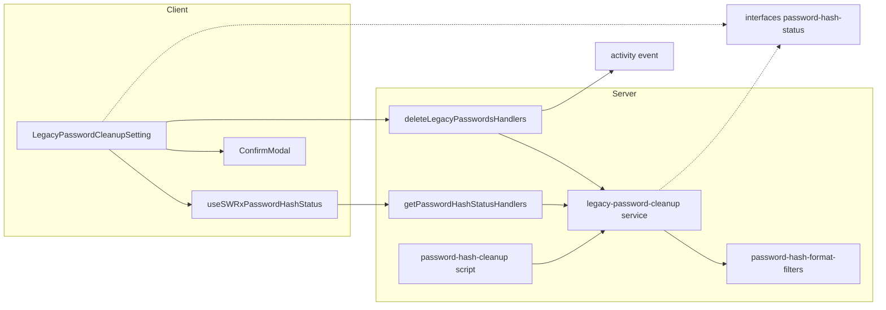
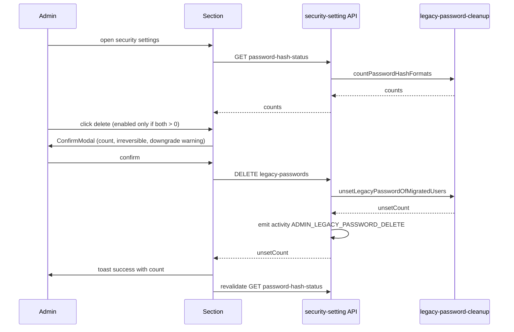

# Design Document: legacy-password-hash-cleanup

## Overview
**Purpose**: サーバーのシェルに入れない GROWI 管理者が、管理画面のセキュリティ設定から次の 2 つを行えるようにする。
- パスワード形式の移行状況を確認する
- 移行済みユーザー（旧形式と新形式の両方を持つユーザー）から旧形式（SHA-256）パスワードを削除する

**Users**: GROWI.cloud などの管理者が、password-hash-upgrade の最終段階（旧形式の後片付け）で使う。

**Impact**: 次の 3 点を変える。
- 既存の cleanup スクリプトから、件数の集計と旧形式の削除を共有サービスに切り出す。スクリプトの挙動は変えない。
- セキュリティ設定 API にエンドポイントを 2 本足す。
- 管理画面にセクションを 1 つ足す。

### Goals
- 4 区分の件数と、未移行ユーザーの ACTIVE 内訳を画面に表示する（1.1–1.5）
- 移行済みユーザーの旧形式パスワードを、中止判定なしで一括削除する（2.1–2.8）
- 確認ダイアログにダウングレード時の影響を警告し、実行を監査ログに残す（3.x, 4.x）
- 削除の基準を、スクリプトと画面で 1 か所の実装として共有する（5.2）

### Non-Goals
- 未移行ユーザーへの催促、メール送信、PASSWORD_SEED の案内
- ダウングレード準備・再アップグレード準備の画面化
- status migration（`20260724000001-password-hash-status.js`）の書き換え
- 監査ログに削除件数を記録すること（snapshot の拡張）。実行者と件数はサーバーログに出す（4.5）
- 監査ログが既定で無効な環境でも記録されるようにすること。action は他の管理者操作と同じく `LargeActionGroup` だけに入れる

## Boundary Commitments

### This Spec Owns
- 共有サービス `legacy-password-cleanup`: 形式ごとの件数の集計と、移行済みユーザーからの旧形式パスワードの除去
- セキュリティ設定 API の 2 エンドポイント: 移行状況の取得と旧形式パスワードの削除。レスポンスの型も含む
- 監査ログの action `ADMIN_LEGACY_PASSWORD_DELETE` と、5 ロケール分のラベル
- 管理画面のセクション `LegacyPasswordCleanupSetting` と、その SWR hook
- `runPasswordHashCleanup` の内部を共有サービス呼び出しに置き換えること（外から見た挙動は変えない）

### Out of Boundary
- 形式分類フィルタ（`password-hash-format-filters.ts`）の定義の変更。この spec は使うだけ
- 未移行の ACTIVE ユーザーがいると中止する判定。これは cleanup スクリプトだけの方針で、共有サービスには入れない
- 認証時のハッシュ検証と遅延移行（password-hash-upgrade が持つ）
- status migration、downgrade-prep、reupgrade-prep スクリプト
- 監査ログの記録ゲートや snapshot の型（activity-log 系 spec が持つ）

### Allowed Dependencies
- `server/models/user/password-hash-format-filters.ts`（分類フィルタ）と `server/models/user/conts.ts`（UserStatus）
- 既存のミドルウェア: `accessTokenParser`、`loginRequired`、`adminRequired`、`generateAddActivityMiddleware`、`crowi.events.activity`
- クライアント: `apiv3-client`、`toastr`、`Admin/App/ConfirmModal`、`swr`
- 依存の向きは次のとおりとし、逆向きの import は禁止する。

  `interfaces` → `models/user`（filters）→ `service/legacy-password-cleanup` → `routes/apiv3/security-settings/*` と `scripts/password-hash-cleanup`

  - クライアントは `interfaces` の型だけを参照し、`server/` は import しない。
  - `scripts/` を `routes/` や `service/` から import してはならない。

### Revalidation Triggers
- 形式分類フィルタの定義が変わったとき（新しい形式の追加や「値なし」の扱いの変更）。件数の区分と削除対象の両方に影響する
- activity-log（記録ゲート）spec で記録対象の action を許可リスト方式にする場合。`ADMIN_LEGACY_PASSWORD_DELETE` を許可リストに入れる必要がある
- `PasswordHashFormatCounts` や API レスポンスの形が変わったとき（クライアントのセクションに影響する）
- password-hash-upgrade で、両形式のユーザーの検証方針（新形式を優先する）が変わったとき（2.8 の前提が崩れる）

## Architecture

### Existing Architecture Analysis
- `runPasswordHashCleanup` は、未移行ユーザーの ACTIVE 内訳を数え、ACTIVE がいれば中止し、いなければ `updateMany(bothFilter, $unset password)` を実行する。この 3 段階が 1 つの関数にまとまっている。
- `security-settings/index.js`（1778 行の JS）は 1 つの `setup(crowi)` に全エンドポイントを持つ。ただし、同じ apiv3 の配下では、エンドポイントごとに TS の handler factory を作って `index` から登録する前例がある（`personal-setting/delete-all-access-tokens.ts` など）。
- 管理画面のセキュリティ設定は unstated container を中心に作られている。一方、新しい管理機能は `stores/admin/*` の SWR hook を使う（`useSWRxExportStatus` など）。

### Architecture Pattern & Boundary Map


- **Selected pattern**: 共有サービスを切り出し、入口を 2 つ（CLI と HTTP）用意する。中止判定は入口側の方針として、スクリプトだけが持つ。
- **New components rationale**:
  - 共有サービス: 5.2 の「同じ基準」をコードとして 1 か所に置くため
  - 2 つの handler ファイル: 1778 行の JS を大きくしないため
  - 型ファイル: クライアントとサーバーの境界をまたいで型を共有するため
- **Steering compliance**:
  - 中核の処理を返り値のある関数にし、入口は薄く保つ（Pure Function Extraction）
  - 中止するかどうかをフラグで切り替えない（Data-Driven Control）
  - クライアントから server を import しない

### Technology Stack
| Layer | Choice / Version | Role in Feature | Notes |
|-------|------------------|-----------------|-------|
| Frontend | React + reactstrap、`swr`（既存） | セクション、確認モーダル、件数の取得と再取得 | 新しい依存はない |
| Backend | Express apiv3（既存） | 2 エンドポイント、権限、監査ログ | 新しい依存はない |
| Data | MongoDB `users` コレクション（mongodb driver の `Collection` 経由。既存スクリプトと同じ） | `countDocuments` と `updateMany($unset)` | スキーマとインデックスは変えない |

## File Structure Plan

### Directory Structure（新規）
```
apps/app/src/
├── interfaces/
│   └── password-hash-status.ts             # PasswordHashFormatCounts と API レスポンスの型（クライアントとサーバーで共有）
├── server/
│   ├── service/
│   │   ├── legacy-password-cleanup.ts       # countPasswordHashFormats / unsetLegacyPasswordOfMigratedUsers
│   │   └── legacy-password-cleanup.integ.ts
│   └── routes/apiv3/security-settings/
│       ├── password-hash-status.ts           # GET handler factory
│       ├── delete-legacy-passwords.ts        # DELETE handler factory（監査ログ付き）
│       └── legacy-password-cleanup.integ.ts  # 2 つの handler の supertest
├── stores/admin/
│   └── password-hash-status.ts              # useSWRxPasswordHashStatus
└── client/components/Admin/Security/
    ├── LegacyPasswordCleanupSetting.tsx      # セクション（件数表、削除ボタン、確認モーダル）
    ├── LegacyPasswordCleanupSetting.spec.tsx
    └── LegacyPasswordCleanupSetting.i18n.spec.ts  # 5 ロケールのキーが揃っているかの検査
```

### Modified Files
- `apps/app/src/server/scripts/password-hash-cleanup.ts`: 未移行ユーザーの内訳は `countPasswordHashFormats` で、削除は `unsetLegacyPasswordOfMigratedUsers` で行うように置き換える。中止の判定、戻り値の型、ログの文言は変えない。
- `apps/app/src/server/routes/apiv3/security-settings/index.js`: 2 つの handler factory を import して登録する（追加は 2 行程度）。
- `apps/app/src/interfaces/activity.ts`: `ACTION_ADMIN_LEGACY_PASSWORD_DELETE` の定数を足し、`SupportedAction` と `LargeActionGroup` に登録する（`ACTION_ADMIN_SECURITY_SETTINGS_UPDATE` と同じ扱い）。
- `apps/app/src/client/components/Admin/Security/SecurityManagementContents.jsx`: `ShareLinkSetting` のセクションの後に `<LegacyPasswordCleanupSetting />` のセクションを足す。
- `apps/app/public/static/locales/{en_US,ja_JP,fr_FR,ko_KR,zh_CN}/admin.json`: `security_settings.legacy_password_cleanup.*` と `audit_log_action.ADMIN_LEGACY_PASSWORD_DELETE` を足す。

## System Flows



- **ボタンを無効にする条件**: 件数の取得中、取得に失敗したとき、`both === 0` のとき（1.5, 2.5）。
- **サーバー側では中止判定をしない**: 対象が 0 件でも正常に応答し、`unsetCount: 0` を返す（2.3, 2.6）。

## Requirements Traceability

| Requirement | Summary | Components | Interfaces | Flows |
|-------------|---------|------------|------------|-------|
| 1.1 | 4 区分の件数を表示 | Service, GET handler, Section | `PasswordHashFormatCounts` | 表示 |
| 1.2 | 未移行ユーザーの ACTIVE 内訳 | Service, Section | `legacyOnly.active / nonActive` | 表示 |
| 1.3 | 「両形式」を削除対象として示す | Section | `both` | 表示 |
| 1.4 | 削除後に件数を更新 | Section, Hook | SWR `mutate` | 削除 → 再取得 |
| 1.5 | 取得に失敗したらエラーを表示し、削除を受け付けない | Section, Hook | `error` | 表示 |
| 2.1 | ステータスを問わず、移行済みユーザー全員から削除 | Service, DELETE handler | `unsetLegacyPasswordOfMigratedUsers` | 削除 |
| 2.2 | 他の区分は変更しない | Service | `bothFilter` だけを対象にする | 削除 |
| 2.3 | 未移行の ACTIVE ユーザーがいても中止しない | Service, DELETE handler | 中止判定なし | 削除 |
| 2.4 | 削除件数を成功メッセージで表示 | DELETE handler, Section | `DeleteLegacyPasswordsResponse` | 削除 |
| 2.5 | 対象が 0 人ならボタンを無効にする | Section | `both === 0` | 表示 |
| 2.6 | 対象が 0 人でも正常に応答する | Service, DELETE handler | `unsetCount: 0` | 削除 |
| 2.7 | エラー時はエラーを表示し、成功は表示しない | Section, DELETE handler | `ErrorV3` | 削除 |
| 2.8 | 現行バージョンでのログインは変わらない | （既存の検証）Service が `passwordHash` に触れないこと | — | — |
| 3.1 | 実行前に確認ダイアログを出す | Section | `ConfirmModal` | 削除 |
| 3.2 | 件数と、取り消せないことを表示 | Section | `warningMessage` | 削除 |
| 3.3 | ダウングレード時の影響を警告 | Section | `supplymentaryMessage` | 削除 |
| 3.4 | キャンセルしたら何もしない | Section | `onCancel` | 削除 |
| 4.1 | 管理者だけに許可 | GET/DELETE handler | `adminRequired`、SCOPE | — |
| 4.2 | 管理者以外は拒否し、データを返さない | GET/DELETE handler | `adminRequired` | — |
| 4.3 | 監査ログが有効で記録対象のときに記録 | DELETE handler, activity.ts | `ADMIN_LEGACY_PASSWORD_DELETE`（`LargeActionGroup`） | 削除 |
| 4.4 | ハッシュの値を表示しない | API の型 | 件数だけを返す | — |
| 4.5 | 実行者と件数をサーバーログに出す | DELETE handler | `logger.info` | 削除 |
| 5.1 | スクリプトの挙動を変えない | cleanup script | `PasswordHashCleanupResult`（変更なし） | — |
| 5.2 | 削除の基準を共有する | Service | `unsetLegacyPasswordOfMigratedUsers` | — |
| 5.3 | 件数の区分を status と同じ定義にする | Service | 共有フィルタ | — |
| 6.1 | 5 ロケール対応 | locales, Section, i18n spec | `admin.json` | — |

## Components and Interfaces

| Component | Domain/Layer | Intent | Req Coverage | Key Dependencies | Contracts |
|-----------|--------------|--------|--------------|------------------|-----------|
| PasswordHashStatus types | interfaces | クライアントとサーバーで共有する型 | 1.1, 1.2, 2.4, 4.4 | — | State |
| legacy-password-cleanup | server/service | 件数の集計と旧形式の除去 | 1.1–1.3, 2.1–2.3, 2.6, 2.8, 5.2, 5.3 | format filters (P0) | Service |
| getPasswordHashStatusHandlers | server/routes | 件数の取得 API | 1.1, 1.5, 4.1, 4.2, 4.4 | Service (P0), adminRequired (P0) | API |
| deleteLegacyPasswordsHandlers | server/routes | 削除 API と監査ログ | 2.1, 2.3, 2.4, 2.6, 2.7, 4.1–4.3, 4.5 | Service (P0), activity event (P1) | API |
| password-hash-cleanup script（変更） | server/scripts | 中止判定を含む CLI | 5.1, 5.2 | Service (P0) | Batch |
| useSWRxPasswordHashStatus | stores/admin | 件数の取得と再取得 | 1.1, 1.4, 1.5 | apiv3Get (P0) | State |
| LegacyPasswordCleanupSetting | client UI | 件数表、削除ボタン、確認 | 1.x, 2.4, 2.5, 2.7, 3.x, 6.1 | Hook (P0), ConfirmModal (P1) | — |

### interfaces

#### PasswordHashStatus types（`interfaces/password-hash-status.ts`）
```typescript
export interface PasswordHashFormatCounts {
  /** passwordHash only (fully migrated) */
  readonly upgradedOnly: number;
  /** both fields present — the deletion target */
  readonly both: number;
  /** password only (not migrated), split by user status */
  readonly legacyOnly: { readonly active: number; readonly nonActive: number };
  /** neither field */
  readonly noPassword: number;
}

export interface PasswordHashStatusResponse {
  readonly counts: PasswordHashFormatCounts;
}

export interface DeleteLegacyPasswordsResponse {
  readonly unsetCount: number;
}
```
- `legacyOnly.active + legacyOnly.nonActive` は、status migration の `legacyOnly` と一致する（`activeUserFilter` と `nonActiveUserFilter` は互いに補集合なので）。

### server/service

#### legacy-password-cleanup（`server/service/legacy-password-cleanup.ts`）

| Field | Detail |
|-------|--------|
| Intent | 形式ごとの件数を集計し、移行済みユーザーから旧形式パスワードを除去する |
| Requirements | 1.1–1.3, 2.1–2.3, 2.6, 2.8, 5.2, 5.3 |

**Responsibilities & Constraints**
- 分類には `password-hash-format-filters` だけを使い、独自の条件を書かない（5.3）。
- 中止判定やステータスによる絞り込みはしない。除去の対象は `bothFilter` に当てはまるユーザー全員（2.1–2.3）。
- `passwordHash` には触れない（2.8 の前提）。
- ログは出さない。実行者を知っているのは呼び出し側（DELETE handler とスクリプト）なので、件数のログは呼び出し側が出す。

**Dependencies**
- Inbound: GET/DELETE handler（P0）、cleanup script（P0）
- Outbound: `password-hash-format-filters`（P0）

**Contracts**: Service [x]

##### Service Interface
```typescript
import type { Collection, Document, Filter } from 'mongodb';
import type { PasswordHashFormatCounts } from '~/interfaces/password-hash-status';

export function countPasswordHashFormats(
  users: Collection,
  baseFilter?: Filter<Document>,
): Promise<PasswordHashFormatCounts>;

export function unsetLegacyPasswordOfMigratedUsers(
  users: Collection,
  baseFilter?: Filter<Document>,
): Promise<{ readonly unset: number }>;
```
- 事前条件: `users` は `users` コレクション。`baseFilter` の既定値は `{}`（コレクション全体）。integ テストでは、マーカーで絞り込むために使う。
- 事後条件（unset）: 呼び出した時点で `bothFilter` に当てはまっていた文書から、`password` フィールドがなくなる。戻り値は `modifiedCount`。
- 不変条件: 何度呼んでも結果は同じ（2 回目は `unset: 0`）。

### server/routes

#### getPasswordHashStatusHandlers / deleteLegacyPasswordsHandlers
**Contracts**: API [x]

`personal-setting/delete-all-access-tokens.ts` と同じく、`(crowi: Crowi) => RequestHandler[]` を返す factory とし、`security-settings/index.js` から登録する。

- `users` コレクションは、リクエストごとに handler の中で `mongoose.connection.collection('users')` から取得し、サービスに渡す（既存のスクリプトと同じ取得方法）。
- `lint:route-guard`（`tools/lint/route-top-level-guard.cjs`）に従い、モジュールのトップレベルには import、型、`loggerFactory(...)` の初期化と factory の宣言だけを置く。コレクションの取得やミドルウェアの生成は、factory か handler の中で行う。

##### API Contract
| Method | Endpoint | Middleware | Response | Errors |
|--------|----------|------------|----------|--------|
| GET | `/_api/v3/security-setting/password-hash-status` | `accessTokenParser([SCOPE.READ.ADMIN.SECURITY])`, `loginRequiredStrictly`, `adminRequired` | `PasswordHashStatusResponse` | 管理者以外は `/` へ 302 リダイレクト（既存の `adminRequired` の挙動）、500 `password-hash-status-fetch-failed` |
| DELETE | `/_api/v3/security-setting/legacy-passwords` | `accessTokenParser([SCOPE.WRITE.ADMIN.SECURITY])`, `loginRequiredStrictly`, `adminRequired`, `addActivity` | `DeleteLegacyPasswordsResponse` | 管理者以外は `/` へ 302 リダイレクト、500 `legacy-password-delete-failed` |

**Implementation Notes**
- DELETE は成功したときだけ `activityEvent.emit('update', res.locals.activity._id, { action: SupportedAction.ACTION_ADMIN_LEGACY_PASSWORD_DELETE })` を呼ぶ。`unsetCount` が 0 でも呼ぶ（実行したという事実を残す）。snapshot は既定のまま。実際に記録されるかどうかは監査ログの設定で決まる（`AUDIT_LOG_ENABLED=true` かつ `LARGE`、または `AUDIT_LOG_ADDITIONAL_ACTIONS` で個別に追加）（4.3）。
- DELETE は成功したとき、監査ログの設定にかかわらず `logger.info` で実行者（`req.user._id` と `username`）と `unsetCount` を 1 行出す（4.5）。
- レスポンスは件数だけを返し、ユーザーの文書は返さない（4.4）。
- OpenAPI の JSDoc は、既存の security-setting エンドポイントの書き方に合わせる。

### server/scripts（変更）

#### password-hash-cleanup
- `runPasswordHashCleanup` の外から見た契約（引数、`PasswordHashCleanupResult`、中止の条件、ログの文言）は変えない（5.1）。
- 中身だけを次のように置き換える。
  - ① 未移行ユーザーの内訳は `countPasswordHashFormats(...).legacyOnly` から取る
  - ③ の削除は `unsetLegacyPasswordOfMigratedUsers` で行う
  - ② の中止判定はスクリプトに残す
- 既存の `password-hash-cleanup.integ.ts` が、変更せずにそのまま通ること。これを回帰の検出に使う。

### client

#### useSWRxPasswordHashStatus（`stores/admin/password-hash-status.ts`）
```typescript
export const useSWRxPasswordHashStatus: () => SWRResponse<PasswordHashFormatCounts, Error>;
```
- `useSWRxExportStatus` に倣い、`useSWRImmutable('/security-setting/password-hash-status', …)` で取得する。削除が成功したら、呼び出し側が `mutate()` で再取得する（1.4）。

#### LegacyPasswordCleanupSetting（`client/components/Admin/Security/LegacyPasswordCleanupSetting.tsx`）
表示だけのコンポーネントなので、概要だけを書く。
- 見出しは `h2.border-bottom`。件数表は 4 区分で、「旧形式のみ」の行に ACTIVE とそれ以外の内訳を併記する。「両形式」の行には、削除対象であることを示す（1.1–1.3）。
- ボタンは `btn-danger`。取得中、取得エラー、`both === 0` のときは `disabled` にする（1.5, 2.5）。取得エラーのときは、件数表の代わりにエラーメッセージを出す。
- 確認には `ConfirmModal` を使う（3.1–3.4）。
  - `warningMessage`: 対象件数と、取り消せないこと
  - `supplymentaryMessage`: ダウングレード時の影響（ACTIVE ユーザーはパスワードリセットで復旧でき、それ以外は個別に対応が必要）
  - `confirmButtonTitle`: 削除
  - `onCancel`: モーダルを閉じるだけ
  - `ConfirmModal` には手を加えない。実行ボタンは既存どおり `btn-outline-primary` のままで、処理中も無効化しない。二重に実行されても、サーバー側の削除が冪等なので実害はない（2 回目は `unsetCount: 0`）。
- 確定したら `apiv3Delete('/security-setting/legacy-passwords')` を呼ぶ。成功したら `toastSuccess`（件数を含む）を出して `mutate()` する。失敗したら `toastError` を出す（2.4, 2.7）。
- 文言はすべて `t('admin:security_settings.legacy_password_cleanup.*')` を使う（6.1）。

## Error Handling
- **件数の取得に失敗**: サーバーは `ErrorV3('…', 'password-hash-status-fetch-failed')` を返し、logger.error を出す。クライアントは、エラーの表示とボタンの無効化を行う。
- **削除に失敗**: サーバーは `ErrorV3('…', 'legacy-password-delete-failed')` を返し、`ADMIN_LEGACY_PASSWORD_DELETE` を emit しない。なお、`addActivity` を通ったリクエストが 400 以上で終わると、既存の fail-safe（`registerFailsafeFinalizer` → `recordFailsafeAttempt`）が `ACTION_UNSETTLED` の試行記録を 1 行残す。これは activity 基盤の既存の挙動で、この spec では変えない。`updateMany` は文書単位でしか原子的でないため、途中で失敗すると一部の文書だけが除去されている可能性がある。ただし操作は冪等なので、再実行すれば残りが除去される。クライアントはエラーをトーストで出し、`mutate()` で実際の件数を表示し直す。
- **同時実行**:
  - 削除の最中に遅延移行で「両形式」になったユーザーは、今回は対象外で、次の実行で除去される。
  - 管理者 2 人が同時に実行しても、冪等なので問題ない。

## Testing Strategy
- **Integration（service: `legacy-password-cleanup.integ.ts`、マーカーを `baseFilter` にする）**
  - 4 区分とステータスを組み合わせたユーザーを用意し、`countPasswordHashFormats` が各区分と ACTIVE 内訳を正しく数えること。空文字や null の `password` は「パスワード未設定」に数えること（1.1, 1.2, 5.3）
  - `unsetLegacyPasswordOfMigratedUsers` が、停止中や招待中を含むすべての「両形式」ユーザーから `password` を除去し、`passwordHash` は残すこと。未移行の ACTIVE ユーザーがいても実行されること（2.1, 2.3）
  - 他の区分（新形式のみ、旧形式のみ、未設定）の文書が変わらないこと（2.2）
  - 2 回目の呼び出しで `unset: 0` になること（2.6）
  - 除去した後も、元のパスワードで `passwordHashService.verify` が成功すること（2.8）
- **Integration（routes: `legacy-password-cleanup.integ.ts`、supertest）**: `file-upload-setting.integ.ts` に倣い、`access-token-parser`、`login-required`、`add-activity` はモックに差し替える。`admin-required` だけは本物を使い、`req.user` に admin が true または false のユーザーを注入する。`vi.mock` はファイル全体に効くので、モックに差し替えると管理者以外の 302 を検証できなくなるため
  - GET のレスポンスが `counts` の数値だけで、ハッシュのフィールドを含まないこと（1.1, 4.4）
  - DELETE が `unsetCount` を返し、`ADMIN_LEGACY_PASSWORD_DELETE` で activity を emit すること（2.4, 4.3）
  - DELETE が成功したとき、実行者と件数を含むログを出すこと（4.5）
  - 管理者でないユーザーで呼んだとき（本物の `adminRequired` に `admin: false` のユーザーを与える）、302 になり、件数を返さず、文書も変更しないこと（4.1, 4.2）
  - サービスが例外を投げたとき、500 のエラーコードを返し、`ADMIN_LEGACY_PASSWORD_DELETE` を emit しないこと（2.7）。fail-safe が残す `ACTION_UNSETTLED` の行は activity 基盤の責任なので、ここでは検証しない
- **Regression**: 既存の `password-hash-cleanup.integ.ts` を変更せずに通すこと（5.1, 5.2）。
- **Component（`LegacyPasswordCleanupSetting.spec.tsx`、RTL）**
  - 件数と ACTIVE 内訳を表示すること（1.1–1.3）
  - `both === 0` のとき、または取得エラーのとき、ボタンが無効になること（1.5, 2.5）
  - 確認モーダルに件数とダウングレードの警告が出ること。キャンセルしたら API が呼ばれないこと（3.1–3.4）
  - 確定して成功したら件数入りのトーストが出て再取得されること。失敗したらエラーのトーストだけが出ること（1.4, 2.4, 2.7）
- **i18n（`LegacyPasswordCleanupSetting.i18n.spec.ts`）**: `features/growi-vault/client/i18n-reconcile.spec.ts` に倣い、追加したすべてのキー（`security_settings.legacy_password_cleanup.*` と `audit_log_action.ADMIN_LEGACY_PASSWORD_DELETE`）が 5 ロケールすべての `admin.json` に空でない文字列として存在することを確かめる。このブランチには i18n キーを検査する lint スクリプトがないので、この spec を 6.1 の検証とする。

## Security Considerations
- 権限: 既存のセキュリティ設定と同じ `adminRequired` と SCOPE（`READ/WRITE.ADMIN.SECURITY`）を使う。アクセストークンで呼ぶ場合も、同じスコープが必要。
- 情報を漏らさない: API が返すのは件数だけで、ユーザー名やハッシュは返さない。
- 取り消せないこと: 確認モーダルで明示する。実行者と件数は、監査ログの設定にかかわらずサーバーログで追える。監査ログが有効で LARGE の環境では、監査ログにも実行者が残る。
