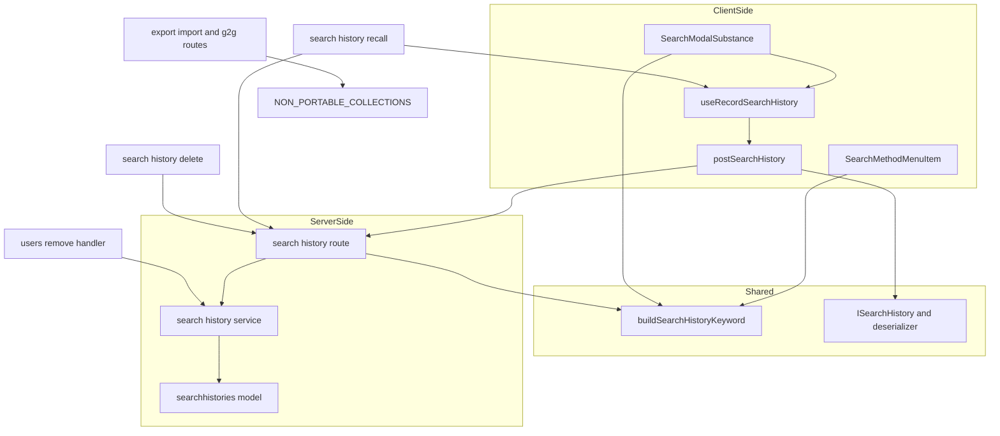
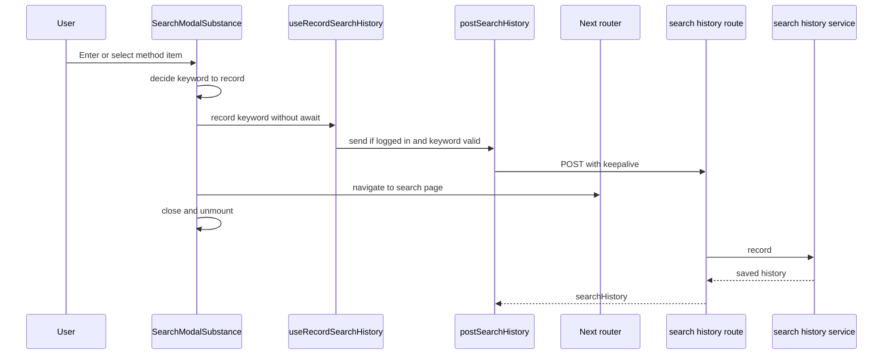
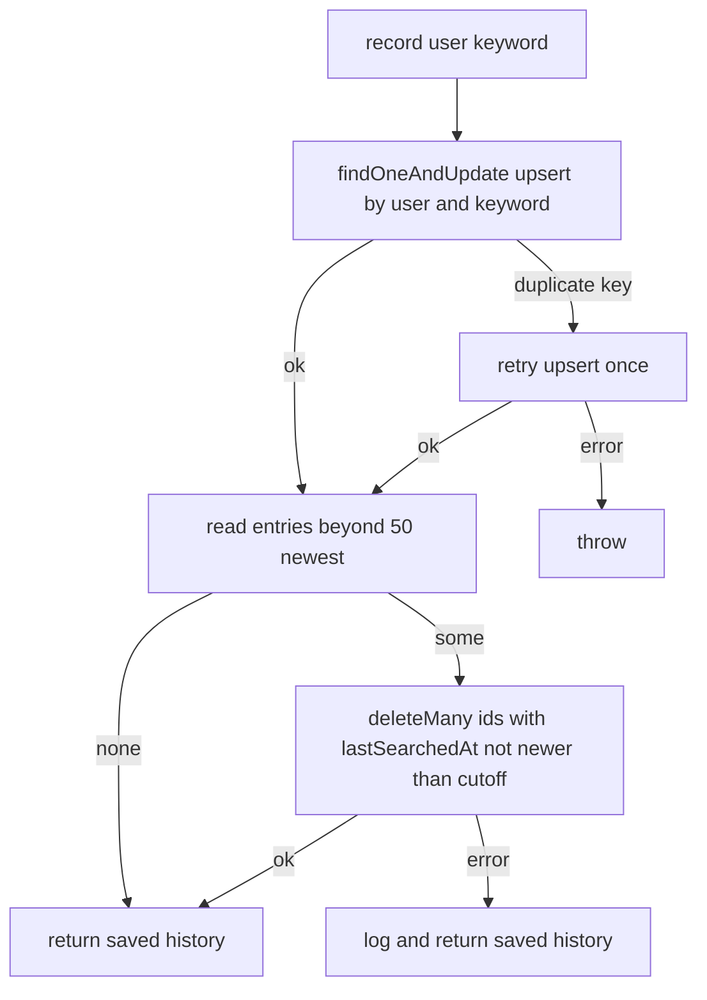

# Design Document: search-history-persistence

## Overview

**Purpose**: ログインユーザーが検索モーダルから検索を実行したとき、入力したキーワードをそのユーザーの検索履歴として保存し、本人の履歴を新しい順に取得できるようにする（チケット #191670）。検索履歴機能（保存・再検索・削除）を束ねるアンブレラ [search-history](../search-history/roadmap.md) の最初の spec で、後続の search-history-recall と search-history-delete が載る土台（データ契約・API・記録点）を作る。

**Users**: ログインユーザーは、意識せずに履歴を残す（検索の操作は変わらない）。search-history-recall は一覧の API と記録の関数を使って履歴を表示し、再検索を記録する。search-history-delete は履歴 1 件の識別子で削除の操作を足す。管理者は、ユーザーの削除とデータ移行で、履歴が残ったり持ち出されたりしないことを当てにする。

**Impact**: 新しいコレクション `searchhistories` と、`/_api/v3/search-history` の `GET /`（一覧）・`POST /`（記録）を足す。検索モーダルの Enter による送信と検索方法メニュー項目の選択に記録を配線する。あわせて、ユーザーを削除済みにするハンドラ、G2G・バックアップのエクスポート・ファイルからのインポートの除外の仕組みを拡張する。検索 API（`GET /_api/search`）と検索結果は変えない。

### Goals
- 検索モーダルからの検索の実行（Enter、検索方法メニュー項目）で、入力どおりのキーワードを保存する（要件 1、2）
- 同じキーワードは 1 件にまとめて最新に繰り上げ、1 ユーザー 50 件に保つ。複数のタブから同時に記録されても、重複せず 50 件を超えない（要件 3）
- 本人の履歴を新しい順に返す一覧と、一覧の 1 件と同じ形を返す記録の API を、`/_api/v3/search-history` の 1 つの窓口にまとめる（要件 4、5）
- 記録の完了を待たずに検索結果ページへ移動し、移動で記録の通信が途中で切れない（要件 6）
- ユーザーの削除で履歴を消し、データ移行の対象から外す（要件 7）

### Non-Goals
- 履歴の表示・選択による再検索の UI、一覧の取得フック（search-history-recall）
- 履歴の削除の API と UI（search-history-delete）
- 検索 API（`GET /_api/search`）、検索結果、検索演算子の解釈の変更
- モーダルを通らない検索（タグのクリック、`/_search` 上のフィルタ・ソート・ページ送り、URL の直接入力、ブラウザの戻る・進む）の記録
- ゲストユーザーの履歴
- 監査ログへの記録、検索履歴専用のアクセストークンのスコープ

## Boundary Commitments

### This Spec Owns
- `searchhistories` コレクション（Mongoose のモデル・スキーマ・インデックス）と、その不変条件「1 ユーザーの中でキーワードは一意」「1 ユーザーの履歴は一覧上 50 件以下」
- 履歴 1 件の型 `ISearchHistory`（`_id`・`keyword`・`lastSearchedAt`）と、応答の解釈 `deserializeSearchHistory`
- 保存する文字列の規則（前後の空白の除去、完全一致の引用符、空の除外、200 文字の上限）とその純関数 `buildSearchHistoryKeyword`、定数 `MAX_SEARCH_HISTORIES_PER_USER`（50）・`MAX_SEARCH_HISTORY_KEYWORD_LENGTH`（200）
- 記録・一覧・利用者単位の削除を行うサービス `search-history` と、同時記録への耐性（一意インデックス、単一の upsert、条件付きの上限の削除）
- `/_api/v3/search-history` の窓口と、その `GET /`・`POST /` の契約（入力、応答、認可、エラー）
- クライアントの記録・取得の手段: keepalive で送る `postSearchHistory`、一覧を型どおりに取得する `getSearchHistories` と、ゲスト判定・失敗の吸収を行う `useRecordSearchHistory`
- 記録点: `SearchModalSubstance` の Enter による送信と項目の選択のハンドラ、`SearchMethodMenuItem` の 3 項目が宣言する記録用の文字列
- `DownshiftItem` の省略可能な項目 `searchHistoryKeyword` の意味（「この項目が選ばれたら、この文字列を履歴に記録する。保存規則は適用済み」）
- 個人データの移行除外の集合 `NON_PORTABLE_COLLECTIONS` と、それをエクスポート・ファイルインポートの経路に適用すること

### Out of Boundary
- `DownshiftItem` の `searchHistoryKeyword` 以外の項目モデル（履歴項目の追加、URL 遷移以外のアクションの表現）、履歴一覧の表示、一覧の取得フック（search-history-recall）
- `DELETE /_api/v3/search-history/:id` と削除の UI（search-history-delete。本スペックが作る窓口のルータに足す）
- 検索 API、`useSetSearchKeyword`、`/_search` のフィルタパネル・チップ・ソート・ページ送り、`onSearchOverride` の先の処理（`SearchControl`、`SearchPage`、`PrivateLegacyPages`）
- 検索演算子（`prefix:` / `tag:` / `author:` など）の解釈。本スペックは文字列として保存するだけ（search-filters）
- `NON_TRANSFERABLE_COLLECTIONS` の既存の基準（運用状態）と、エクスポート・インポート・G2G の取り込みの仕組みそのもの
- ユーザーの削除・一時停止の仕組みそのもの（本スペックは削除済みにするハンドラに 1 行足すだけ）
- 共通の `apiv3-client`（`apiv3Get` / `apiv3Post`）と共通の axios インスタンスの設定。本スペックはどちらも変えない

### Allowed Dependencies
モジュール単位の依存は、次の層の順で左（番号の小さい側）にだけ向ける。

1. **共有の型と規則**（`features/search/interfaces/search-history.ts`、`features/search/utils/search-history-keyword.ts`、`features/search/utils/deserialize-search-history.ts`）: 標準ライブラリだけに依存する。server・client のどちらのコードも import しない
2. **サーバのデータ層**（`features/search/server/models/search-history.ts`）: 1、Mongoose、`~/server/util/mongoose-utils`（`getOrCreateModel`）
3. **サーバのサービス**（`features/search/server/services/search-history.ts`）: 1、2、`~/utils/logger`
4. **サーバの route**（`features/search/server/routes/apiv3/search-history.ts`）: 1、3、既存の認可・検証の部品（`accessTokenParser`、`loginRequiredFactory`、`apiV3FormValidator`、express-validator、`ErrorV3`）。`Crowi` の型は factory の引数として受け取るだけ
5. **既存のサーバへの配線**（`routes/apiv3/index.js`、`routes/apiv3/users.js`、`crowi/setup-models.ts`）: 2〜4 の公開された入口だけを import する
6. **クライアントの送信**（`features/search/client/services/search-history-api.ts`）: 1、共通の axios インスタンス（`~/utils/axios`）
7. **クライアントの記録フック**（`features/search/client/hooks/use-record-search-history.ts`）: 1、6、`useIsGuestUser`（`~/states/context`）、`~/utils/logger`
8. **記録点**（`SearchModal.tsx`、`SearchMethodMenuItem.tsx`、`client/interfaces/downshift.ts`）: 1、7

その他:
- client のコードは server のコード（2〜4）を import しない
- 除外の集合 `NON_PORTABLE_COLLECTIONS` は `server/service/import/non-transferable-collections.ts` に置き、エクスポート・インポートの route はそこから読む。`features/search` のコードを import しない（コレクション名の文字列で扱う）

### Revalidation Triggers
- `ISearchHistory` の項目の変更、一覧・記録の応答のキー（`searchHistories` / `searchHistory`）の変更（recall・delete・外部の API 利用者に影響）
- 同一キーワードの判定、保持件数、並び順、保存する文字列の規則の変更（recall の表示と再検索、delete の前提に影響）
- `/_api/v3/search-history` の窓口の場所、認可（スコープ、`loginRequiredStrictly`）の変更（delete が同じ窓口・同じ認可に揃える前提）
- `DownshiftItem.searchHistoryKeyword` の意味の変更、または recall による `DownshiftItem` の形の変更（選択のハンドラが記録する前提が崩れる）
- `useRecordSearchHistory` の契約（失敗で reject しない、ゲストでは何もしない）の変更（recall の再検索が当てにする）
- 共通の axios インスタンスの応答変換・ヘッダーの変更（送信・取得関数が `transformResponse` を差し替え、ヘッダーを引き継ぐ前提）
- recall が一覧の取得に `getSearchHistories` 以外（`apiv3Get` など）を使うこと（ISO 形式のキーワードが `Date` に化ける）
- 検索モーダルの実行経路の追加・変更（新しい実行経路で記録が漏れる。例: モーダルに新しい検索方法の項目を足す）
- 利用者を削除済みにする経路の追加（履歴の削除を足し忘れる）
- エクスポート・ファイルインポート・G2G に新しい入口が増えること（`NON_PORTABLE_COLLECTIONS` の適用が漏れる）
- 検索履歴専用のアクセストークンのスコープを足すこと

## Architecture

### Existing Architecture Analysis
- 検索の入力は検索モーダル（`features/search/client/components/SearchModal.tsx`、Downshift）に集約されている。自動の `prefix:` も完全一致の引用符も付いていない入力は、`SearchModalSubstance` の `searchInput` だけが持つ。
- 実行は 2 経路。Enter による送信は `SearchForm`（空白のみなら送信しない）→ `SearchModalSubstance.submitHandler` → `SearchModal.searchHandler`（`onSearchOverride` か、`prefix:` を付けて `useSetSearchKeyword`）。検索方法メニュー項目の選択は Downshift の `onSelect` → `selectSearchMenuItemHandler` → `router.push(selectedItem.url)`。ページ候補（`SearchResultMenuItem`）の選択も同じハンドラを通る。
- Downshift は、ハイライトされた項目がある状態の Enter を項目の選択として扱い、フォームの送信を止める。1 回の Enter で送信と選択の両方が走ることは無い。
- 遷移はすべて Next.js のクライアント側遷移。遷移でモーダルはアンマウントされる。Next.js は遷移に失敗するとページ全体の読み込みに切り替える。
- apiv3 の本人データの API は `bookmark-folder` が前例（`setup(crowi): Router`、`POST /`・`DELETE /:id`、`res.apiv3({ <名前>: ... })`）。
- 共通の axios インスタンス（`~/utils/axios`）は `X-Requested-With` と `Content-Type: application/json` を付け、応答の ISO 形式の文字列をすべて `Date` に変える。サーバは同一オリジンかを `certifyOrigin` で確かめるだけで、CSRF トークンは使わない。
- ユーザーの削除はソフト削除（`statusDelete()`）で、後始末は `/:id/remove` のハンドラに直接書かれている。後始末のフックは無い。
- `NON_TRANSFERABLE_COLLECTIONS` は G2G だけが使う。バックアップのエクスポートとファイルからのインポートには、コレクションを除外する仕組みが無い。

### Architecture Pattern & Boundary Map



**Architecture Integration**:
- Selected pattern: 既存 feature（`features/search/`）の拡張。共有の型と規則・サーバ・クライアントを同じ feature に置く（news、page-bulk-export と同じ構成）。
- Domain/feature boundaries: 保存規則は共有の純関数 1 つに集め、クライアントの記録点とサーバの検証が同じ関数を使う。サーバは保存規則を最終的に保証する側で、クライアントの判定は不要な通信を省くためのもの。
- Existing patterns preserved: `setup(crowi): Router`、`res.apiv3({ 名前: ... })`、`accessTokenParser` → `loginRequiredStrictly` → 検証 → `apiV3FormValidator` の順、Mongoose のモデルによるインデックスの作成、ハンドラ直書きの後始末。
- New components rationale: 送信関数（keepalive と応答の解釈のため共通の `apiv3Post` を使えない）、記録フック（ゲスト判定と失敗の吸収を 1 か所にまとめ、recall と共有する）、除外の集合（個人データの除外の基準を運用状態と分ける）。
- Steering compliance: Feature-Based Architecture、server-client の分離、named export、純関数の抽出、データ駆動（項目が記録する文字列を宣言する）。

### Technology Stack

| Layer | Choice / Version | Role in Feature | Notes |
|-------|------------------|-----------------|-------|
| Frontend | React、Downshift、Next.js Pages Router（既存） | 記録点の配線 | 新しい依存なし |
| Frontend 通信 | axios 1.15（既存、`adapter: 'fetch'`）、Fetch API `keepalive` | 遷移・文書の破棄で切れない記録の送信 | `fetchOptions` は axios 1.7 以降で対応 |
| Backend | Express、express-validator（既存） | `/_api/v3/search-history` | 新しい依存なし |
| Data | MongoDB（レプリカセット）、Mongoose（既存） | `searchhistories` の保存とインデックス | Prisma は使わない（Decision は research.md） |

## File Structure Plan

### Directory Structure
```
apps/app/src/features/search/
├── interfaces/
│   └── search-history.ts                 # ISearchHistory、上限の定数（server・client 共有）
├── utils/
│   ├── search-history-keyword.ts         # buildSearchHistoryKeyword（保存規則の純関数）
│   ├── search-history-keyword.spec.ts
│   ├── deserialize-search-history.ts     # 応答の 1 件を ISearchHistory にする純関数
│   └── deserialize-search-history.spec.ts
├── server/
│   ├── models/
│   │   └── search-history.ts             # Mongoose のスキーマ・インデックス・モデル
│   ├── services/
│   │   ├── search-history.ts             # record / list / deleteByUser、同時記録への耐性
│   │   └── search-history.integ.ts
│   └── routes/apiv3/
│       ├── search-history.ts             # setup(crowi): Router（GET / と POST /）
│       └── search-history.integ.ts
└── client/
    ├── services/
    │   ├── search-history-api.ts         # postSearchHistory（keepalive）と getSearchHistories
    │   └── search-history-api.spec.ts
    └── hooks/
        ├── use-record-search-history.ts  # ゲスト判定・失敗の吸収をする記録の関数
        └── use-record-search-history.spec.ts
```

### Modified Files
- `apps/app/src/features/search/client/interfaces/downshift.ts` — `DownshiftItem` に省略可能な `searchHistoryKeyword?: string` を足す
- `apps/app/src/features/search/client/components/SearchMethodMenuItem.tsx` — 3 項目がそれぞれ記録用の文字列（`buildSearchHistoryKeyword` の結果。`null` なら持たない）を項目に載せる
- `apps/app/src/features/search/client/components/SearchModal.tsx` — `SearchModalSubstance` の `submitHandler` と `selectSearchMenuItemHandler` で、遷移の前に `useRecordSearchHistory` の関数を待たずに呼ぶ
- `apps/app/src/server/routes/apiv3/index.js` — `router.use('/search-history', setupSearchHistory(crowi))` を `bookmark-folder` の並びに足す
- `apps/app/src/server/routes/apiv3/users.js` — `/:id/remove` のハンドラで、`externalaccounts` の削除の後に `deleteSearchHistoriesByUser` を呼ぶ
- `apps/app/src/server/crowi/setup-models.ts` — `setupIndependentModels` に検索履歴のモデルを足す
- `apps/app/src/server/service/import/non-transferable-collections.ts` — `NON_PORTABLE_COLLECTIONS`（`searchhistories`）を足し、`NON_TRANSFERABLE_COLLECTIONS` がそれを含むようにする
- `apps/app/src/server/routes/apiv3/mongo.js` — `GET /collections` の結果から `NON_PORTABLE_COLLECTIONS` を除く
- `apps/app/src/server/routes/apiv3/export.js` — `generateZipFile` の検証で `NON_PORTABLE_COLLECTIONS` を含む要求を拒否する
- `apps/app/src/server/routes/apiv3/import.ts` — `POST /upload` が返す中身の一覧と、`POST /` の取り込み対象（`fileStatsToImport`）から `NON_PORTABLE_COLLECTIONS` を除く（`excludeNonPortableFileStats`）
- `apps/app/src/server/service/import/import.ts` — `getStatus()` が返す各 zip の中身の一覧から除く（同じ関数）
- `apps/app/src/server/service/import/non-transferable-collections.spec.ts` — 既存の `drops %s` の `test.each` に `searchhistories` を足し、`excludeNonPortableFileStats` の単体テストを足す
- エクスポート・インポートの route の統合テスト（`export.js`・`import.ts` の隣に新設または既存に追加） — 除外の振る舞いのテストを足す

## System Flows

### 検索の実行から記録まで



- 記録は遷移の **前に** 送り始め、待たない（要件 6.1）。送信は keepalive の fetch なので、モーダルのアンマウント、Next.js の全体読み込みへの切り替え、タブを閉じる操作のあとも、ブラウザが送信を続ける。
- 記録の関数は、送信後にコンポーネントの状態に触れない。失敗はブラウザのログに残し、ユーザーには何も表示しない（要件 6.2）。サーバ側の失敗はサーバのログに残す（要件 6.3）。

### 同時記録への耐性（サービスの record）



- 一意インデックス `{ user, keyword }` で、同じキーワードの同時記録は 1 件にまとまる（要件 3.1）。片方の upsert が E11000 になっても、再試行で既存の文書の更新になる。
- 上限の削除は、読んだ時点の最終検索日時（境界）以前の文書だけを消す。読んだ後に別のタブが繰り上げた履歴は境界より新しくなるので消えない。記録のたびに削除が走り、最後に走った削除が先行するすべての挿入を見るので、保存件数は 50 件以下に戻る（要件 3.4、3.5）。
- 挿入と削除の間に保存件数が 51 件以上になる瞬間があるが、一覧は常に同じ並びで 50 件に絞るので、利用者からは 50 件以下に見える。

## Requirements Traceability

| Requirement | Summary | Components | Interfaces | Flows |
|-------------|---------|------------|------------|-------|
| 1.1 | Enter で記録 | SearchModalSubstance, useRecordSearchHistory | `submitHandler` | 検索の実行から記録まで |
| 1.2 | `/_search` 上のモーダルの Enter で記録 | SearchModalSubstance | `submitHandler`（`onSearchOverride` の分岐より前） | 同上 |
| 1.3 | 検索方法メニュー項目で記録 | SearchMethodMenuItem, SearchModalSubstance | `DownshiftItem.searchHistoryKeyword`, `selectSearchMenuItemHandler` | 同上 |
| 1.4 | フィルタ・ソート・ページ送りで記録しない | 記録点の限定 | モーダル外の `useSetSearchKeyword` に配線しない | — |
| 1.5 | ページ候補の選択で記録しない | SearchModalSubstance | `searchHistoryKeyword` を持たない項目は記録しない | — |
| 1.6 | モーダルを通らない `/_search` で記録しない | 記録点の限定 | モーダルのハンドラ以外に記録点を置かない | — |
| 1.7 | 他の画面から記録できる手段 | useRecordSearchHistory, postSearchHistory | `RecordSearchHistory` | 同上 |
| 2.1 | 前後の空白を除いて保存 | buildSearchHistoryKeyword, route の検証 | `buildSearchHistoryKeyword` | — |
| 2.2 | 演算子トークンをそのまま保存 | buildSearchHistoryKeyword | 文字列の加工は空白の除去と引用符だけ | — |
| 2.3 | 自動の `prefix:` を含めない | SearchModalSubstance | `searchInput` から作る（`searchHandler` の前） | — |
| 2.4 | 「子ページを検索」で `prefix:` を含めない | SearchMethodMenuItem | 入力だけから `searchHistoryKeyword` を作る | — |
| 2.5 | 「完全一致」は引用符付き | SearchMethodMenuItem, buildSearchHistoryKeyword | `method: 'exactMatch'` | — |
| 2.6 | 空のキーワードは保存しない | buildSearchHistoryKeyword, useRecordSearchHistory, route の検証 | `null` を返す、400 | — |
| 2.7 | 200 文字超は保存しない、検索は実行 | buildSearchHistoryKeyword, route の検証 | `null` を返す、400。記録点は遷移を止めない | — |
| 3.1 | 同一キーワードは繰り上げ | SearchHistoryService, SearchHistoryModel | `recordSearchHistory`、一意インデックス | 同時記録への耐性 |
| 3.2 | 完全一致のみ同一とみなす | SearchHistoryModel | 一意インデックス（照合順序なし＝バイナリ比較） | — |
| 3.3 | 繰り上げで識別子を変えない | SearchHistoryService | `$setOnInsert`、upsert | 同上 |
| 3.4 | 1 ユーザー最大 50 件 | SearchHistoryService | 上限の削除、一覧の `limit` | 同上 |
| 3.5 | 古いものから削除 | SearchHistoryService | `lastSearchedAt` 降順・`_id` 降順の 51 件目以降 | 同上 |
| 4.1 | 本人の履歴を新しい順に返す | route, SearchHistoryService | `GET /`、`listSearchHistories` | — |
| 4.2 | 識別子・キーワード・最終検索日時 | ISearchHistory | `ISearchHistory` | — |
| 4.3 | 記録の応答は一覧の 1 件と同じ形 | route, deserializeSearchHistory | `POST /` の `searchHistory` | — |
| 4.4 | 履歴が無ければ空の一覧 | route | `{ searchHistories: [] }` | — |
| 5.1 | 本人の履歴だけを読み書き | route, SearchHistoryService | `req.user._id` だけを使う | — |
| 5.2 | 他人を指定する手段が無い | route | URL・本文・クエリに利用者 ID を受け取らない | — |
| 5.3 | 未ログインは拒否 | route | `loginRequiredStrictly`（403） | — |
| 5.4 | ゲストは記録せずエラーも出さない | useRecordSearchHistory | `useIsGuestUser` で送信しない | — |
| 6.1 | 記録の完了を待たずに遷移 | SearchModalSubstance, postSearchHistory | 待たずに呼ぶ、keepalive | 検索の実行から記録まで |
| 6.2 | 失敗しても検索を妨げず表示しない | useRecordSearchHistory | reject しない、toast を出さない | 同上 |
| 6.3 | 失敗をログに残す | route, SearchHistoryService, useRecordSearchHistory | サーバの `logger.error`、ブラウザの `logger.error` | 同上 |
| 6.4 | 検索結果を変えない | 境界 | 検索 API・`searchHandler` の結果を変えない | — |
| 7.1 | 削除済みで消す、一時停止では消さない | users.js `/:id/remove`, SearchHistoryService | `deleteSearchHistoriesByUser` | — |
| 7.2 | エクスポートの対象外 | NON_PORTABLE_COLLECTIONS, mongo.js, export.js | 一覧から除く、要求を拒否 | — |
| 7.3 | インポートの対象外 | NON_PORTABLE_COLLECTIONS, import.ts | 中身の一覧・取り込み対象から除く | — |
| 7.4 | G2G の対象外 | NON_TRANSFERABLE_COLLECTIONS | 既存の G2G の除外 | — |

## Components and Interfaces

| Component | Domain/Layer | Intent | Req Coverage | Key Dependencies (P0/P1) | Contracts |
|-----------|--------------|--------|--------------|--------------------------|-----------|
| ISearchHistory と定数 | 共有 | 履歴 1 件の型と上限 | 3.4, 4.2 | — | State |
| buildSearchHistoryKeyword | 共有 | 保存する文字列を決める | 2.1, 2.2, 2.5, 2.6, 2.7 | — | Service |
| deserializeSearchHistory | 共有 | 応答の 1 件を型どおりにする | 4.2, 4.3 | ISearchHistory (P0) | Service |
| SearchHistoryModel | サーバ / データ | 保存とインデックス | 3.1, 3.2 | Mongoose (P0) | State |
| SearchHistoryService | サーバ / サービス | 記録・一覧・利用者単位の削除 | 3.1〜3.5, 4.1, 5.1, 6.3, 7.1 | SearchHistoryModel (P0) | Service |
| SearchHistoryRoute | サーバ / API | `/_api/v3/search-history` | 2.1, 2.6, 2.7, 4.1〜4.4, 5.1〜5.3, 6.3 | SearchHistoryService (P0), 認可の部品 (P0) | API |
| postSearchHistory / getSearchHistories | クライアント / 通信 | keepalive で記録を送る、一覧を取得する | 1.7, 4.1, 4.3, 6.1 | 共通の axios (P0) | Service |
| useRecordSearchHistory | クライアント / フック | ゲスト判定と失敗の吸収 | 1.7, 5.4, 6.2, 6.3 | postSearchHistory (P0), useIsGuestUser (P0) | Service |
| 記録点（SearchModalSubstance、SearchMethodMenuItem、DownshiftItem） | クライアント / UI | 実行とみなす箇所で記録する | 1.1〜1.6, 2.3〜2.5, 6.1 | useRecordSearchHistory (P0) | State |
| NON_PORTABLE_COLLECTIONS と各経路 | サーバ / データ移行 | 個人データを移行から外す | 7.2, 7.3, 7.4 | 既存の export / import / g2g (P0) | Batch |
| ユーザー削除の後始末 | サーバ / 既存 route | 削除済みで履歴を消す | 7.1 | SearchHistoryService (P0) | Service |

### 共有

#### ISearchHistory と定数

| Field | Detail |
|-------|--------|
| Intent | 履歴 1 件の形と、保持件数・文字数の上限 |
| Requirements | 3.4, 4.2 |

```typescript
// features/search/interfaces/search-history.ts
export const MAX_SEARCH_HISTORIES_PER_USER = 50;
export const MAX_SEARCH_HISTORY_KEYWORD_LENGTH = 200;

export interface ISearchHistory {
  readonly _id: string;
  readonly keyword: string;
  readonly lastSearchedAt: Date;
}

// The wire form of ISearchHistory (JSON); lastSearchedAt is an ISO 8601 string.
export interface ISearchHistorySerialized {
  readonly _id: string;
  readonly keyword: string;
  readonly lastSearchedAt: string;
}
```
- 利用者 ID は応答に含めない（本人の分しか返さないため不要。要件 5.2）。
- 型は `features/search/interfaces/` に置く（apps/app の中でしか使わないので `@growi/core` には置かない）。

#### buildSearchHistoryKeyword

| Field | Detail |
|-------|--------|
| Intent | 入力と検索方法から、保存する文字列を決める（保存しないなら `null`） |
| Requirements | 2.1, 2.2, 2.5, 2.6, 2.7 |

**Contracts**: Service [x]

```typescript
// features/search/utils/search-history-keyword.ts
export type SearchHistoryMethod = 'plain' | 'exactMatch';

export const buildSearchHistoryKeyword = (
  input: string,
  method: SearchHistoryMethod,
): string | null;
```
- 手順: 前後の空白を除く → 空なら `null` → `exactMatch` なら `"` で囲む → code point の数が `MAX_SEARCH_HISTORY_KEYWORD_LENGTH` を超えたら `null` → その文字列。
- 内部の空白、大文字小文字、演算子トークン、入力に含まれる引用符は変えない（要件 2.2、3.2）。
- 文字数は code point で数える（`[...s].length`）。クライアントとサーバの両方がこの関数で判定するので、数え方が食い違わない。
- サーバは、本文の `keyword` に `'plain'` で適用する（クライアントが付けた引用符はそのまま。前後の空白の除去は冪等）。

#### deserializeSearchHistory

| Field | Detail |
|-------|--------|
| Intent | 応答の 1 件（JSON）を `ISearchHistory` にする |
| Requirements | 4.2, 4.3 |

```typescript
// features/search/utils/deserialize-search-history.ts
export const deserializeSearchHistory = (
  raw: ISearchHistorySerialized,
): ISearchHistory;
```
- `lastSearchedAt` だけを `Date` にし、`keyword` は文字列のまま返す。共通の axios の自動変換（ISO 形式の文字列をすべて `Date` にする）を通さない値に使う。
- 一覧の取得は `getSearchHistories` がこの関数で 1 件ずつ解釈する。

### サーバ

#### SearchHistoryModel

| Field | Detail |
|-------|--------|
| Intent | `searchhistories` の保存と、一意性・並びのためのインデックス |
| Requirements | 3.1, 3.2 |

**Contracts**: State [x]

- モデル名 `SearchHistory`、コレクション名 `searchhistories`（Mongoose の既定の複数形）。`getOrCreateModel` で登録する。
- 項目: `user`（ObjectId、`User` を参照、必須）、`keyword`（String、必須）、`lastSearchedAt`（Date、必須）。`timestamps` と `__v` は使わない（`versionKey: false`）。
- インデックス:
  - `{ user: 1, keyword: 1 }`、unique — 同一キーワードの一意性（要件 3.1）。照合順序は指定しない（バイナリ比較で大文字小文字・内部の空白を区別する。要件 3.2）
  - `{ user: 1, lastSearchedAt: -1, _id: -1 }` — 一覧と上限の削除の並び
- `schema.prisma` には宣言しない。読み書きはサービスだけが行う。

#### SearchHistoryService

| Field | Detail |
|-------|--------|
| Intent | 記録（upsert と上限の維持）、一覧、利用者単位の削除 |
| Requirements | 3.1, 3.2, 3.3, 3.4, 3.5, 4.1, 5.1, 6.3, 7.1 |

**Responsibilities & Constraints**
- 利用者の ID は呼び出し側（route、ユーザー削除のハンドラ）から受け取る。サービスは認可をしない。
- 受け取るキーワードは、保存規則を適用済みであることを前提とする（route が検証する）。
- トランザクションは使わない。単一文書の原子的な操作と条件付きの削除で、同時記録に耐える。

**Dependencies**
- Inbound: SearchHistoryRoute — 記録・一覧（P0）。ユーザー削除のハンドラ — 利用者単位の削除（P0）。search-history-delete — 1 件の削除をこのサービスに足す（P1）
- Outbound: SearchHistoryModel — 読み書き（P0）

**Contracts**: Service [x]

```typescript
// features/search/server/services/search-history.ts
import type { Types } from 'mongoose';

export const recordSearchHistory = (
  userId: Types.ObjectId | string,
  keyword: string,
): Promise<ISearchHistory>;

export const listSearchHistories = (
  userId: Types.ObjectId | string,
): Promise<ISearchHistory[]>;

export const deleteSearchHistoriesByUser = (
  userId: Types.ObjectId | string,
): Promise<void>;
```

- `recordSearchHistory`
  - Preconditions: `keyword` は `buildSearchHistoryKeyword(keyword, 'plain') === keyword` を満たす。
  - 処理: `findOneAndUpdate({ user, keyword }, { $currentDate: { lastSearchedAt: true }, $setOnInsert: { user, keyword } }, { upsert: true, new: true })`。E11000 なら同じ操作を 1 回だけ再試行する。その後、上限の削除を行う。
  - 上限の削除: `{ user }` を `lastSearchedAt` 降順・`_id` 降順で並べた 51 件目以降の `_id` と `lastSearchedAt` を読み、空でなければ、その中の最も新しい `lastSearchedAt` を境界 `cutoff` として `deleteMany({ user, _id: { $in: ids }, lastSearchedAt: { $lte: cutoff } })` を行う。
  - Postconditions: 返す履歴はその時点で保存されている（既存なら `_id` は変わらず `lastSearchedAt` だけが新しい）。上限の削除の完了後、その時点までに完了したすべての記録を含めて、保存件数は 50 件以下。
  - Errors: upsert（再試行を含む）の失敗は例外として投げる。上限の削除の失敗は `logger.error` に残して握りつぶし、記録の結果を返す（次の記録の削除で回復する）。
- `listSearchHistories`
  - `{ user }` を `lastSearchedAt` 降順・`_id` 降順で並べ、`MAX_SEARCH_HISTORIES_PER_USER` 件に絞って返す。無ければ空配列。
- `deleteSearchHistoriesByUser`
  - `deleteMany({ user })`。失敗は例外として投げる。
- Invariants: 1 ユーザーの中で `keyword` は一意。一覧は常に 50 件以下。

**Implementation Notes**
- Integration: `_id` は文字列にして返す（`ISearchHistory`）。
- Validation: 同時記録の振る舞いは統合テストで確かめる（Testing Strategy）。
- Risks: 上限の削除の失敗が続くと保存件数が増え続ける。ログで検知する。

#### SearchHistoryRoute

| Field | Detail |
|-------|--------|
| Intent | `/_api/v3/search-history` の窓口（一覧・記録） |
| Requirements | 2.1, 2.6, 2.7, 4.1, 4.2, 4.3, 4.4, 5.1, 5.2, 5.3, 6.3 |

**Responsibilities & Constraints**
- `export const setup = (crowi: Crowi): Router`。ルータはファクトリの中で作る。`index.js` の利用者向けルータに `router.use('/search-history', setupSearchHistory(crowi))` で載せる。
- 対象の利用者は常に `req.user._id`。URL・本文・クエリから利用者 ID を受け取らない（要件 5.1、5.2）。
- search-history-delete は、このルータに `DELETE /:id` を足す（同じ認可の並びに揃える）。

**Dependencies**
- Inbound: クライアントの `postSearchHistory`（P0）、search-history-recall の一覧の取得（P0）、外部の API 利用者（P2）
- Outbound: SearchHistoryService（P0）、buildSearchHistoryKeyword（P0）
- External: `accessTokenParser`、`loginRequiredFactory`、express-validator、`apiV3FormValidator`（P0）

**Contracts**: API [x]

##### API Contract

| Method | Endpoint | Middleware | Request | Response | Errors |
|--------|----------|-----------|---------|----------|--------|
| GET | `/_api/v3/search-history` | `accessTokenParser([SCOPE.READ.FEATURES.PAGE], { acceptLegacy: true })` → `loginRequiredStrictly` | なし | `200 { searchHistories: ISearchHistorySerialized[] }`（新しい順、最大 50 件、無ければ `[]`） | 403（未ログイン）、500 |
| POST | `/_api/v3/search-history` | `accessTokenParser([SCOPE.WRITE.FEATURES.PAGE], { acceptLegacy: true })` → `loginRequiredStrictly` → 検証 → `apiV3FormValidator` | `{ keyword: string }` | `200 { searchHistory: ISearchHistorySerialized }`（新規・繰り上げとも） | 400（検証）、403（未ログイン）、500 |

- 検証（POST）: `body('keyword')` が文字列で、`buildSearchHistoryKeyword(value, 'plain')` が `null` でないこと。満たさなければ 400（`apiV3FormValidator` の `{ errors: [...] }`）。ハンドラは `buildSearchHistoryKeyword` の結果（前後の空白を除いた文字列）を保存する。
- エラー: サービスの例外は `logger.error` に残し、`res.apiv3Err(new ErrorV3('Failed to record search history', 'search_history_record_failed'), 500)`（一覧は `'search_history_list_failed'`）を返す（要件 6.3）。内部の詳細は応答に含めない。
- `addActivity` と `excludeReadOnlyUser` は付けない（監査ログに検索キーワードを残さない。読み取り専用ユーザーも本人の履歴を持つ）。
- 冪等性: 同じ `keyword` の POST を繰り返しても履歴は 1 件で、`lastSearchedAt` が進むだけ。

### クライアント

#### postSearchHistory / getSearchHistories

| Field | Detail |
|-------|--------|
| Intent | 文書の破棄・遷移で切れない方法で記録を送る。一覧と記録の応答を型どおりに解釈する |
| Requirements | 1.7, 4.1, 4.3, 6.1 |

**Contracts**: Service [x]

```typescript
// features/search/client/services/search-history-api.ts
export const postSearchHistory = (keyword: string): Promise<ISearchHistory>;
export const getSearchHistories = (): Promise<ISearchHistory[]>;
```
- `getSearchHistories` は `GET /_api/v3/search-history` を、`postSearchHistory` と同じ `transformResponse` の差し替えで取得し、各要素を `deserializeSearchHistory` で返す。共通の `apiv3Get` は設定を受け取れず、日付の自動変換で ISO 形式の `keyword` が `Date` になるため使わない。本スペックには一覧の表示が無いので取得フック（SWR）は作らず、recall の取得フックはこの関数を fetcher として使う。
- 共通の axios インスタンス（`~/utils/axios`）で `POST /_api/v3/search-history` を送る。要求の設定に `adapter: 'fetch'`、`fetchOptions: { keepalive: true }` を付け、`transformResponse` は JSON の解釈だけにする（共通の日付変換を通さない）。応答の `searchHistory` を `deserializeSearchHistory` で返す。
- ヘッダー（`X-Requested-With`、`Content-Type`）と Cookie（`credentials: 'same-origin'`）は共通のインスタンスの既定を引き継ぐ。`withCredentials` は指定しない（`false` にすると Cookie が送られない）。
- 失敗は reject する（吸収は `useRecordSearchHistory` の責務）。
- 共通の `apiv3Post` は使わず、変更もしない（設定を受け取らないため。理由は research.md）。

#### useRecordSearchHistory

| Field | Detail |
|-------|--------|
| Intent | 検索の実行を記録する関数を返す。ゲストでは何もせず、失敗で reject しない |
| Requirements | 1.7, 5.4, 6.2, 6.3 |

**Contracts**: Service [x]

```typescript
// features/search/client/hooks/use-record-search-history.ts
export type RecordSearchHistory = (
  keyword: string | null | undefined,
) => Promise<ISearchHistory | null>;

export const useRecordSearchHistory = (): RecordSearchHistory;
```
- `keyword` は保存規則を適用済みの文字列（`buildSearchHistoryKeyword` の結果）。`null` / `undefined` / 空、またはゲスト（`useIsGuestUser()`）なら送信せず `null` で解決する（要件 2.6、2.7、5.4）。
- 送信の失敗は `logger.error` に残して `null` で解決する。reject しない。toast などの表示はしない（要件 6.2）。
- 記録点は `void record(keyword)` と待たずに呼ぶ（要件 6.1）。結果を使いたい画面（recall）は `await` してよい。
- 返す関数は送信後にコンポーネントの状態に触れない（呼び出し元がアンマウントされても安全）。

#### 記録点（SearchModalSubstance、SearchMethodMenuItem、DownshiftItem）

| Field | Detail |
|-------|--------|
| Intent | 「検索を実行した」とみなす 2 つのハンドラで記録する |
| Requirements | 1.1, 1.2, 1.3, 1.4, 1.5, 1.6, 2.3, 2.4, 2.5, 6.1 |

**Contracts**: State [x]

```typescript
// features/search/client/interfaces/downshift.ts
export type DownshiftItem = {
  url: string;
  // Recorded to the search history when this item is selected; already normalized
  // by buildSearchHistoryKeyword. Items without it are not recorded.
  searchHistoryKeyword?: string;
};
```

- `SearchMethodMenuItem` の各項目が、選ばれたら記録する文字列を宣言する。
  - 「全体を検索」: `buildSearchHistoryKeyword(searchKeyword, 'plain')`
  - 「子ページを検索」: `buildSearchHistoryKeyword(searchKeyword, 'plain')`（`prefix:<現在のページ>` は含めない。要件 2.4。入力が空なら `null` で、項目は記録しない。要件 2.6）
  - 「完全一致」: `buildSearchHistoryKeyword(searchKeyword, 'exactMatch')`（要件 2.5）
  - 結果が `null` の項目は `searchHistoryKeyword` を持たない。URL の組み立ては変えない。
- `SearchModalSubstance`
  - `submitHandler`: `record(buildSearchHistoryKeyword(searchInput, 'plain'))` を待たずに呼んでから、従来どおり `onSearch(searchInput)` と `closeSearchModal()`。`onSearchOverride` の分岐と `prefix:` の付与は親の `searchHandler` の中なので、記録は両方の経路（要件 1.1、1.2）を通り、自動の `prefix:` を含まない（要件 2.3）。
  - `selectSearchMenuItemHandler`: `record(selectedItem.searchHistoryKeyword)` を待たずに呼んでから、従来どおり `router.push`。ページ候補（`SearchResultMenuItem`）は `searchHistoryKeyword` を持たないので記録しない（要件 1.5）。
- 1 回の Enter で送信と選択の両方が走らない（Downshift がハイライト中の Enter で送信を止める）ので、二重記録は起きない。
- モーダルの外（`/_search` のフィルタ・ソート・ページ送り、タグのクリック、URL の直接入力、戻る・進む）には記録点を置かない（要件 1.4、1.6）。
- `PrivateLegacyPages` から開いたモーダルの Enter も、モーダルからの検索の実行として記録される（要件 1.1 の範囲）。

### サーバ / データ移行・ユーザー削除

#### NON_PORTABLE_COLLECTIONS と各経路

| Field | Detail |
|-------|--------|
| Intent | 利用者の個人データを、エクスポート・ファイルインポート・G2G のどの経路でも環境の外へ出さず、外から入れない |
| Requirements | 7.2, 7.3, 7.4 |

**Contracts**: Batch [x]

- `non-transferable-collections.ts` に `export const NON_PORTABLE_COLLECTIONS: ReadonlySet<string> = new Set(['searchhistories'])` を足し、基準（「利用者の個人データで、どの経路でもこの環境の外へ出さない」）を説明する。`NON_TRANSFERABLE_COLLECTIONS` はその要素を含める（既存の基準「運用状態」とは別の理由として明記する）。
- 適用する経路:

| 経路 | 場所 | 振る舞い |
|------|------|---------|
| G2G（押す側の候補・押す処理・受ける側） | `g2g-transfer.ts`（既存） | `NON_TRANSFERABLE_COLLECTIONS` に含まれるので、既存の処理で外れる（要件 7.4） |
| エクスポートの候補 | `mongo.js` `GET /collections` | 結果から除く（画面の選択肢に出ない） |
| エクスポートの実行 | `export.js` `generateZipFile` の検証 | 含む要求を 400（`Invalid collections`）で拒否する（要件 7.2） |
| インポートの中身の一覧（アップロード直後） | `import.ts` `POST /upload` | 返す `innerFileStats` から除く |
| インポートの中身の一覧（画面の再読み込み時） | `ImportService.getStatus()`（`GET /import/status`） | 各 zip の `innerFileStats` から除く |
| インポートの実行 | `import.ts` `POST /` の `fileStatsToImport` | 要求に含まれていても取り込まない（要件 7.3） |

- インポートの 3 か所は、同じ純関数 `excludeNonPortableFileStats(innerFileStats)`（`non-transferable-collections.ts`）を通す。zip の解析（`growiBridgeService.parseZipFile`）はエクスポートの状態表示と G2G の受信でも使われ、zip の中身をそのまま報告する責務なので、そこでは除かない。
- 画面の一覧に出さないことで、選べるのに黙って取り込まれない状態を作らない。実行時の除外は、古い画面や API の直接の呼び出しへの守り。

- 分類漏れの統合テスト（`non-transferable-collections.integ.ts`）は、モデルを `setupIndependentModels` に登録することで `searchhistories` を見つけ、`NON_TRANSFERABLE_COLLECTIONS` に含まれていることで通る。

#### ユーザー削除の後始末

| Field | Detail |
|-------|--------|
| Intent | 削除済みにしたとき、その利用者の検索履歴をすべて消す |
| Requirements | 7.1 |

- `users.js` の `DELETE /:id/remove` のハンドラで、`prisma.externalaccounts.deleteMany` の後に `await deleteSearchHistoriesByUser(user._id)` を呼ぶ。失敗はハンドラの既存の例外処理（500）に従う。
- 一時停止（`/:id/deactivate`）など再開できる操作には足さない。

## Data Models

### Domain Model
- 集約は「利用者ごとの検索履歴」。1 件の履歴は（利用者、キーワード）で一意で、最終検索日時を持つ。
- 不変条件: 同じ利用者の中でキーワードは一意。利用者に見える履歴は最終検索日時の新しい順で最大 50 件。繰り上げで識別子は変わらない。

### Physical Data Model

**Collection** `searchhistories`

| Field | Type | Notes |
|-------|------|-------|
| `_id` | ObjectId | 履歴 1 件の識別子（delete が使う） |
| `user` | ObjectId | `users._id`。必須 |
| `keyword` | String | 保存規則を適用済み（最大 200 code point）。必須 |
| `lastSearchedAt` | Date | 最後に検索した日時（DB サーバの時刻）。必須 |

| Index | Keys | Options | Purpose |
|-------|------|---------|---------|
| `user_1_keyword_1` | `{ user: 1, keyword: 1 }` | unique | 同一キーワードの一意性、upsert の対象の特定 |
| `user_1_lastSearchedAt_-1__id_-1` | `{ user: 1, lastSearchedAt: -1, _id: -1 }` | — | 一覧と上限の削除の並び |

- インデックスは Mongoose のスキーマで作る（`.claude/rules/model.md`）。新しいコレクションなので、既存データの移行（migration script）は要らない。

### Data Contracts & Integration
- 応答は JSON。`_id` は 24 桁の 16 進文字列、`lastSearchedAt` は ISO 8601 文字列。
- 一覧と記録の応答の 1 件は同じ形（`ISearchHistorySerialized`、要件 4.3）。クライアントでは `deserializeSearchHistory` で `ISearchHistory` にする。

## Error Handling

### Error Strategy
- 記録は検索の付随物で、どの失敗も検索を止めない。クライアントは失敗を吸収し、サーバはログに残す。

### Error Categories and Responses
- **入力の誤り（400）**: 文字列でない、前後の空白を除くと空、200 文字超の `keyword`。クライアントは事前に判定して送らないので、通常は発生しない。
- **未ログイン（403）**: `loginRequiredStrictly` が拒否する（要件 5.3）。クライアントはゲストでは送らないので、通常は発生しない。
- **サーバの失敗（500）**: DB の失敗。サーバは `logger.error` に利用者 ID と操作の種類を残す（キーワードはログに残さない）。応答は汎用のメッセージだけ。
- **上限の削除の失敗**: 記録は成功として返し、`logger.error` に残す。
- **クライアントの送信の失敗**: `useRecordSearchHistory` が `logger.error` に残して `null` で解決する。表示はしない（要件 6.2）。

### Monitoring
- サーバのログ（`growi:features:search:search-history` 系の logger 名）で、記録・一覧・上限の削除の失敗を追える（要件 6.3）。

## Testing Strategy

### Unit Tests
- `buildSearchHistoryKeyword`: 前後の空白の除去、内部の空白と大文字小文字の保持、演算子トークンの保持、`exactMatch` の引用符（空白を除いた後で囲む）、空白のみで `null`、200 code point ちょうどは保存・201 は `null`、引用符を含めて 201 になる完全一致は `null`、サロゲートペアを 1 文字と数える（要件 2.1、2.2、2.5、2.6、2.7）
- `deserializeSearchHistory`: `lastSearchedAt` が `Date` になり、ISO 形式の `keyword` は文字列のまま（要件 4.2、4.3）
- `postSearchHistory` / `getSearchHistories`: 一覧は各要素を `ISearchHistory` にし、ISO 形式の `keyword` が文字列のまま。記録は `POST /_api/v3/search-history` に `{ keyword }` を送り、要求の設定に `adapter: 'fetch'` と `fetchOptions.keepalive === true` があり、応答を `ISearchHistory` で返す（要件 6.1、4.3）
- `useRecordSearchHistory`: ゲストでは送らず `null`、`null`/空のキーワードでは送らない、送信の失敗で reject せず `null` を返しログに残す（要件 5.4、6.2、6.3）

### Integration Tests（`*.integ.ts`、実際の MongoDB）
- サービス: 新規の記録、同じキーワードの再記録で `_id` が変わらず `lastSearchedAt` が進む、大文字小文字・内部の空白の違いは別の履歴、51 件目の記録で最も古い 1 件が消える、一覧が新しい順で最大 50 件、他の利用者の履歴は返さない（要件 3.1〜3.5、4.1、5.1）
- サービスの同時記録: 同じキーワードを並行に 10 回記録して 1 件になる。異なるキーワードを 50 件の状態から並行に記録して、完了後に保存件数が 50 件で、最新のものが残る。上限の削除の対象を読んだ後に繰り上げられた履歴が消えない（削除の条件を直接確かめる）（要件 3.1、3.4、3.5、ユーザー指示）
- route: GET の応答の形と空の一覧、POST の応答が一覧の 1 件と同じ形、空白のみ・201 文字・文字列でない `keyword` で 400、`req.user` の履歴だけを扱い、本文に別の利用者 ID を入れても無視される（要件 4.1〜4.4、5.1、5.2、2.6、2.7）。未ログインの拒否は `loginRequiredStrictly` を通した構成で 403（要件 5.3）
- ユーザー削除: `/:id/remove` で対象の利用者の履歴だけが消え、`/:id/deactivate` では残る（要件 7.1）
- データ移行: `NON_TRANSFERABLE_COLLECTIONS` が `searchhistories` を含み、分類漏れのテストが通る。エクスポートの候補に出ず、実行の要求は 400。インポートの中身の一覧に出ず、要求に含めても取り込まれない（要件 7.2〜7.4）

### Component Tests（`*.spec.tsx`）
- `SearchModal`: Enter で入力（前後の空白を除く）が記録され、記録を待たずに `onSearch` が呼ばれる。`isSearchScopeChildrenAsDefault` が有効でも `prefix:` を含まない。`onSearchOverride` 付きで開いても記録される。ページ候補の選択では記録されない（要件 1.1、1.2、1.5、2.3、6.1）
- `SearchMethodMenuItem` ＋ 選択: 3 項目の選択でそれぞれ入力・入力・`"入力"` が記録され、「子ページを検索」は `prefix:` を含まない。入力が空のときの「子ページを検索」では記録されない。キーボードでハイライトして Enter したときに 1 回だけ記録される（要件 1.3、2.4、2.5、2.6）
- 記録が reject しないこと（フックの失敗時）で、遷移とモーダルを閉じる処理が続く（要件 6.2）

### E2E / Manual
- ログインして検索モーダルで検索し、すぐに別ページへ移動・タブを閉じても、`GET /_api/v3/search-history` に記録が残る（要件 6.1、ユーザー指示）
- 2 つのタブで同じ・異なるキーワードを続けて検索し、一覧に重複が無く 50 件以下（要件 3）

## Security Considerations
- 対象の利用者は常にセッション（またはアクセストークン）の `req.user`。利用者 ID を受け取る口を持たないので、他人の履歴を読み書きできない（要件 5.1、5.2）。
- `keyword` は文字列であることを検証し、文字列としてだけ問い合わせに使う（`mongoSanitize` も全体に掛かっている）。正規表現の問い合わせには使わない。
- 検索キーワードは個人的な内容なので、監査ログ・サーバのログに残さず、データ移行の対象から外す（要件 7）。
- 同一オリジンかの確認は既存の `certifyOrigin` に任せる。keepalive の fetch も `Origin` を送るので、既存の確認がそのまま働く。

## Performance & Scalability
- 記録 1 回あたり、upsert 1 回・上限の読み取り 1 回（インデックスで 51 件目以降だけ）・必要なときだけ削除 1 回。検索 API と並行に走り、検索の応答を待たせない。
- 一覧はインデックス `{ user, lastSearchedAt, _id }` で最大 50 件を読む。
